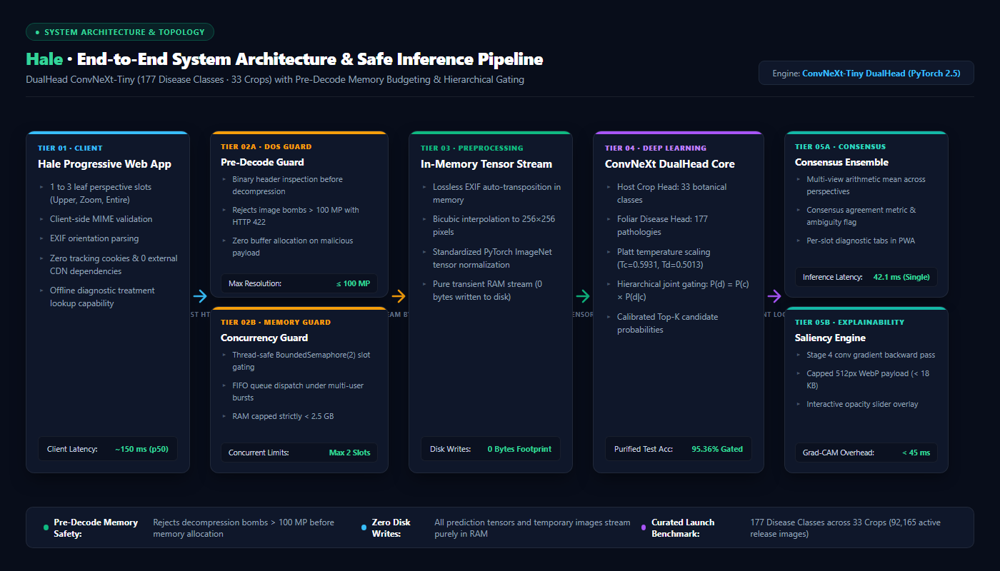

# Hale

**Foliar crop and disease diagnosis from a leaf photo, with calibrated confidence, selective abstention (UNCERTAIN), and Grad-CAM visual attention.**

[](docs/DATASET_LICENSE.md)
[](LICENSE)
[](pyproject.toml)
[](tests/)

---

## 1. Live Demo

- **Interactive Web Application:** Available at deployment URL (see frontend repository).
- **Interface Preview:** High-resolution architecture and interface diagrams are documented in [docs/FEATURES_GUIDE.md](docs/FEATURES_GUIDE.md).

*First load may take up to a minute (free-tier sleep).*  
**Notice:** Research prototype; not for commercial use (CC BY-NC-SA 4.0).

---

## 2. Why This Exists

A farmer needs an answer they can verify. General-purpose plant identifiers often stop at broad categories, and chat-based tools can answer differently for the same photo. Hale is deterministic for a given model version and preprocessing, names a specific crop and disease, shows where the model looked, links to reference photos, and says UNCERTAIN when unsure. It does not claim to never err.

---

## 3. What It Does

- **Dual-Head Taxonomic Gating:** Joint host crop (33 crops) and pathology prediction (177 foliar conditions) enforcing $P(\text{diagnosis}) = P(\text{crop}) \times P(\text{disease} \mid \text{crop})$.
- **Temperature-Scaled Calibration:** Minimizes overconfidence via post-hoc vector temperature scaling ($T_{\text{crop}} = 0.5931$, $T_{\text{disease}} = 0.5013$), lowering ECE to 0.57%.
- **Selective Abstention:** Rejection threshold at $\tau = 0.60$ routes uncertain inputs to an UNCERTAIN triage state for re-photographing.
- **Grad-CAM Saliency Maps:** Visualizes convolutional attention on the leaf surface with user-controlled opacity overlay.
- **Multi-View Consensus:** Supports evaluating 1 to 3 leaf photos (benefit over single view not yet measured).
- **Reference Wiki & Verifiable Ledger:** 177-condition botanical library with reference photos, public licensing ledger, and single-page diagnostic PDF export.

---

## 4. Headline Results

Evaluated on the leak-quarantined clean test partition ($N=9,279$) using CPU inference (`src.models.predict.predict_tensor`, recorded in `reports/v1/results.json`):

| Metric | Point Estimate | 95% Bootstrap CI | Notes |
|:---|:---:|:---:|:---|
| **Host Crop Accuracy** | **99.28%** | [99.11%, 99.44%] | 33 botanical host crop species |
| **Soft-Gated Disease Accuracy** | **96.02%** | [95.62%, 96.45%] | Joint crop-gated diagnosis (8,910 / 9,279 correct) |
| **Raw Disease Accuracy** | **95.83%** | [95.42%, 96.25%] | Disease head alone without crop gating |
| **Macro-F1 (All 177 classes)** | **93.86%** | [91.84%, 94.42%] | Unweighted macro average across all classes |
| **Macro-F1 ($N \ge 10$ test images)** | **96.54%** | [95.96%, 97.00%] | Evaluated across 147 classes with $\ge 10$ test support |
| **Expected Calibration Error (ECE)** | **0.57%** | — | Calibrated across 15 equal-frequency bins |
| **Coverage ($\tau = 0.60$)** | **96.98%** | — | 8,999 / 9,279 clean test images evaluated |
| **Covered Accuracy ($\tau = 0.60$)** | **97.52%** | — | 8,776 / 8,999 correct diagnoses |
| **Abstained Subset Accuracy** | **47.86%** | — | 134 / 280 correct on deferred uncertain images |

*Tested on curated research images; field performance not yet measured. See [Known Limitations](#6-known-limitations).*

---

## 5. Engineering Decisions Worth Reading

- **Background-Removal Ablation:** Testing on 1,500 test images showed that synthetic background removal (U2-Net) causes a 30.07 percentage-point drop in classification accuracy (from 96.33% to 66.27%) by masking chlorotic margins and lesion halos; it is disabled in production ([docs/FEATURES_GUIDE.md#81-operational-mechanisms](docs/FEATURES_GUIDE.md#81-operational-mechanisms)).
- **Label Audit (Patch P-005):** Manual review of 195 classes led to 3,062 relabels, 498 merges, and 4,665 quarantined images, resolving non-foliar, ambiguous, and cross-species leaf contaminations ([docs/PATCH_LINEAGE.md#3-patch-p-005-deep-botanical-curation-dossier-5-relabels-1-merge-17-quarantined-classes-3-outlier-images--195-to-177-classes](docs/PATCH_LINEAGE.md#3-patch-p-005-deep-botanical-curation-dossier-5-relabels-1-merge-17-quarantined-classes-3-outlier-images--195-to-177-classes)).
- **Split-Leakage Detection (Patches P-006 & P-007):** Re-splitting introduced near-duplicate twins. Detected using perceptual hashing ($d \le 4$), quantified the effect (test accuracy 96.10% to 96.02%), and quarantined 181 leaking test twins ([docs/PATCH_LINEAGE.md#4-known-consequence-of-patch-p-006](docs/PATCH_LINEAGE.md#4-known-consequence-of-patch-p-006)).

---

## 6. Known Limitations

- **Curated Benchmark Scope:** Trained and evaluated on curated research datasets; no independent field evaluation published.
- **Small Test Support:** 30 of 177 classes have fewer than 10 clean test images.
- **Residual Validation Leakage:** 162 validation images still have 260 near-duplicate twin pairs in the 73,356 training images (calibration and $\tau$ were tuned on the 9,349 validation split of the 91,984 total active images; sensitivity is small, see docs).
- **Closed-World Classifier:** A uniform skin-tone patch produced a confident wrong answer (out-of-distribution gap).
- **Multi-View Performance:** Multi-view benefit over single view is not yet measured.
- **Visual Assessment:** Label corrections are the author's visual assessment, not lab-confirmed.
- **Withdrawn Visuals:** 66 conditions have wiki images withdrawn pending licence verification.
- **Pathology Credentials:** Labels are not certified by a plant pathologist.
- **Licensing & Rights:** Training data includes web-sourced images whose upstream licences are unverified; weights are therefore released for non-commercial research only (CC BY-NC-SA 4.0). Dataset images are not redistributed; the manifest lists each file's source, licence and SHA-256.

---

## 7. Architecture



```text
Upload -> Pixel/Size Guards -> EXIF + Resize 256x256 -> ConvNeXt-Tiny DualHead -> Temperature Scaling -> Crop Gating -> Threshold (tau=0.60) -> Result (+ optional Grad-CAM)
```

The service enforces a single image cap of 50 MP, an aggregate request budget of 100 MP, a 10 MB payload limit, a concurrency ceiling of 2 via semaphore, and a per-IP sliding-window rate limit of 60 req/min, with a measured server RSS of 716 MB to 729 MB idle, 1,268 MB peak during multi-view Grad-CAM, and 1.67 GB under two concurrent 3x25 MP requests.

---

## 8. Quickstart

### Model Weights

Model weights are distributed as a GitHub Release asset with SHA-256 `3bb5785efa957a5fd4eb9d071fa92ff57adbef9788275a810e9cce99cf016dcb`; use `scripts/download_weights.py` after the release exists.

```bash
# 1. Clone repository
git clone https://github.com/Khushii1811/plant-disease-backend.git
cd plant-disease-backend

# 2. Install dependencies with uv
uv sync

# 3. Start the FastAPI server
uv run uvicorn serving.main:app --host 0.0.0.0 --port 8000
```

Sample prediction via `curl`:
```bash
curl -X POST "http://localhost:8000/api/v1/predict" \
  -H "accept: application/json" \
  -H "Content-Type: multipart/form-data" \
  -F "file=@sample_leaf.jpg;type=image/jpeg"
```

---

## 9. Documentation Index

See the full index in [docs/README.md](docs/README.md):
- [docs/FEATURES_GUIDE.md](docs/FEATURES_GUIDE.md): Architecture, calibration, selective classification, features, and server guardrails.
- [docs/PATCH_LINEAGE.md](docs/PATCH_LINEAGE.md): Complete dataset history P-001 to P-007, Patch P-005 curation and evidence dossier, leakage audits, and residual risks.
- [docs/DATASET_CARD.md](docs/DATASET_CARD.md): Dataset composition, split distributions, and botanical sources.
- [docs/DATASET_LICENSE.md](docs/DATASET_LICENSE.md): Upstream dataset licensing, commercial restrictions, and withdrawn classes.
- [docs/essays/DATA_CENTRIC_ODYSSEY_DOCUMENTARY.md](docs/essays/DATA_CENTRIC_ODYSSEY_DOCUMENTARY.md): Part 1: Forensic dataset engineering, burst-photo leakage elimination, and botanical negative controls.
- [docs/essays/CHLOROPHYLL_AND_CONVOLUTIONS.md](docs/essays/CHLOROPHYLL_AND_CONVOLUTIONS.md): Part 2: 177-class ConvNeXt-Tiny DualHead architecture design, pathology-preserving transforms, and training under 4GB VRAM constraints.

---

## 10. Safety, License, Citation

Automated visual decision-support tool; not a licensed plant pathologist; verify with an extension officer; follow the pesticide label and pre-harvest intervals.

- **Model Weights & Metadata:** Released under [CC BY-NC-SA 4.0](docs/DATASET_LICENSE.md) (non-commercial, not licensed for commercial deployment).
- **Source Code:** Released under the [MIT License](LICENSE).
- **Third-Party Attribution:** See [NOTICE.md](NOTICE.md) for upstream dataset, benchmark, and asset licensing details.
- **Citation:** See [CITATION.cff](CITATION.cff) for bibtex and citation metadata.

**Author:** Khushi Patel (GitHub: [@Khushii1811](https://github.com/Khushii1811))  
**Repositories:** [Backend (Hale)](https://github.com/Khushii1811/plant-disease-backend) | [Frontend](https://github.com/Khushii1811/plant-disease-frontend)


---

## 11. Security & Repository Hygiene

Do not commit API tokens, secrets, .env files, or raw dataset images to this repository. All private credentials, experiment tokens, and local image datasets must remain gitignored.
