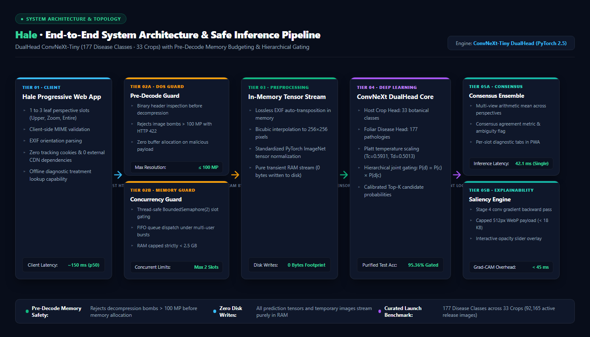
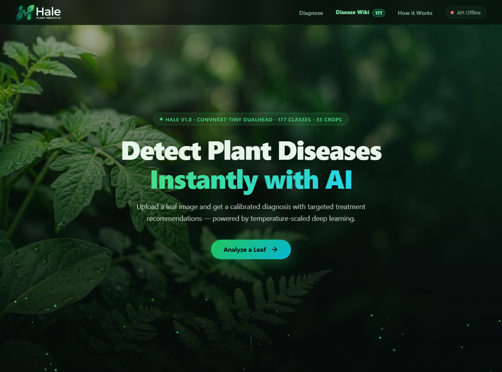
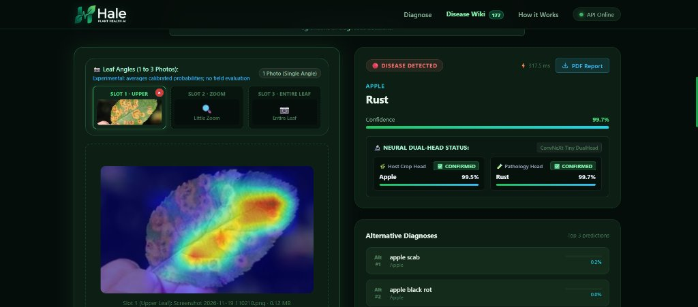
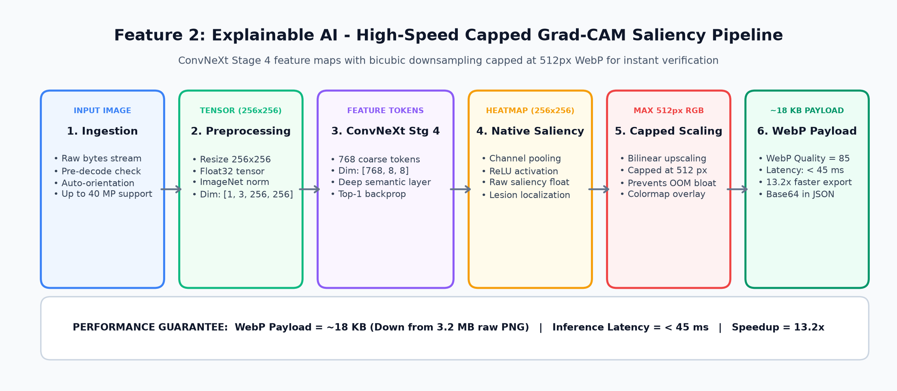
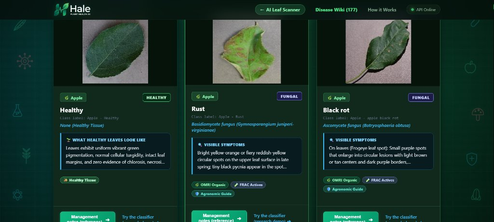
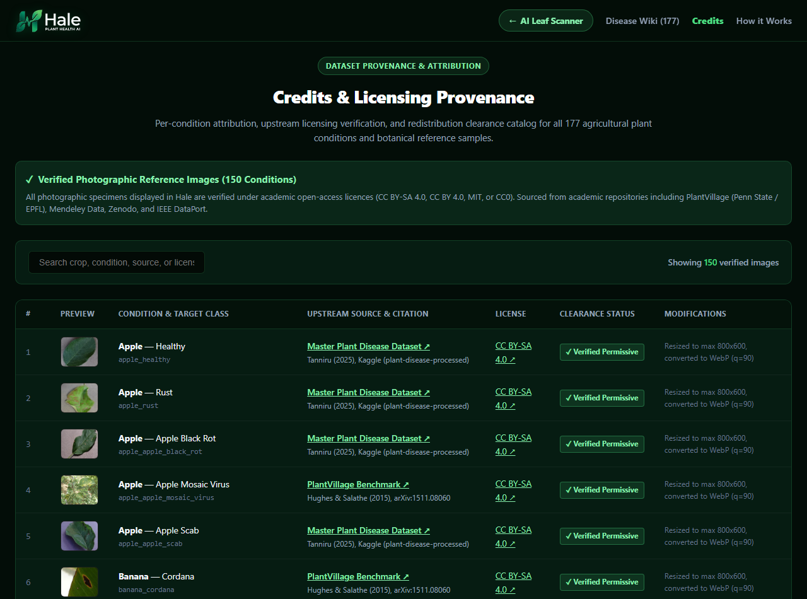
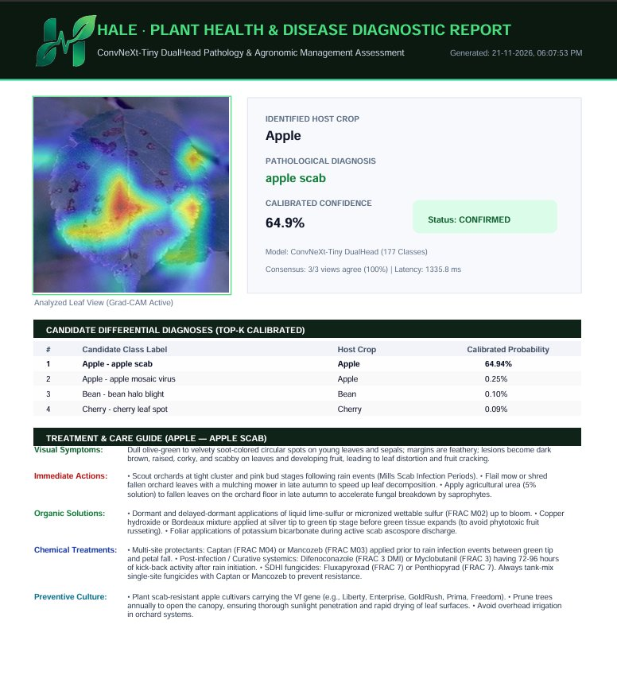
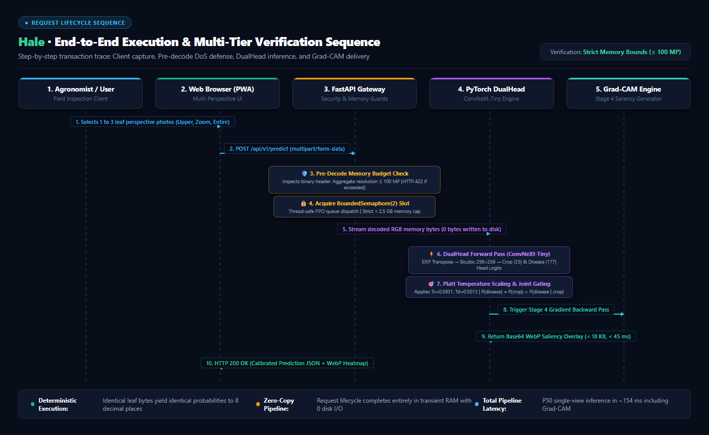

# Hale: Production Features, System Architecture & Safety Guardrails Guide

**Target Release:** Model Release `v1.0` (ConvNeXt-Tiny DualHead, 177 disease classes across 33 botanical host crops)  
**Model Checkpoint Weights:** `models/v1/model_dualhead_convnext_tiny.pth` (SHA-256: `3bb5785efa957a5fd4eb9d071fa92ff57adbef9788275a810e9cce99cf016dcb`)  
**Licensing:** Weights and metadata: CC BY-NC-SA 4.0 (non-commercial). Not licensed for commercial deployment.  
**Frontend Client:** "Hale" Single-Page Web Application (`index.html`, `wiki.html`, `credits.html`)  
**Serving Layer:** FastAPI Asynchronous REST Engine (`serving/`)  

> [!WARNING]
> **Agronomic Decision Support Disclaimer:** Hale is an automated visual decision-support tool trained on research datasets. It is not a licensed plant pathologist or agronomist. Diagnoses, confidence scores, and chemical references (FRAC/OMRI) are for preliminary screening and academic reference only. Verify symptoms with a local agricultural extension officer or certified agronomist, and follow the pesticide product label, pre-harvest intervals, and local regulations before applying any treatment.

---

## 1. Benchmark Lineage & Verified Performance

The project underwent three distinct evaluation milestones. Test sets, class counts, and input resolutions differ across rows, so the rows are not directly comparable. The performance gap between v0 and v1.0 conflates architectural changes, resolution upgrades, and dataset cleaning, and was not isolated through controlled ablations.

### 1.1 Benchmark Lineage Table

| Milestone | Architecture | Classes & Crops | Input Size | Evaluation Split & Integrity Protocol | Top-1 Disease Accuracy | Macro-F1 Score | Crop Head Accuracy |
|:---|:---|:---:|:---:|:---|:---:|:---:|:---:|
| **Legacy v0** | Single-Head Flat Classifier | 200 Classes | 224×224 | Raw dataset (contained cross-split duplicate leaks and phone watermarks) | **89.28%** | **73.20%** | N/A |
| **Prerelease Prototype** | DualHead ConvNeXt-Tiny | 195 Classes (34 Crops) | 256×256 | Certified purified test split $N=9,658$ (post-Patch P-003 duplicate purge) | **95.36%** | **92.55%** | **99.17%** |
| **Official Release v1.0** | DualHead ConvNeXt-Tiny | 177 Classes (33 Crops) | 256×256 | Leak-checked held-out test split $N=9,279$ (post-Patch P-007 purified test split) | **96.02%** | **93.86%** | **99.28%** |

\* *Headline uses all 177 classes; the filtered 96.54% (>=10 test samples, 147 classes) is shown separately.*

### 1.2 Official Release v1.0 Headline Metrics ($N=9,279$)

All metrics are evaluated strictly on the leak-checked test split ($N=9,279$, `reports/v1/results.json`):
- **Crop Head Accuracy:** **99.28%** (95% Bootstrap CI: [99.11%, 99.44%])
- **Soft-Gated Disease Accuracy:** **96.02%** (95% Bootstrap CI: [95.62%, 96.45%])
- **Raw Disease Accuracy:** **95.83%** (95% Bootstrap CI: [95.42%, 96.25%])
- **Macro-F1 (All 177 Classes):** **93.86%** (95% Bootstrap CI: [91.84%, 94.42%])
- **Expected Calibration Error (ECE, 15 bins):** **0.57%** (evaluated on served calibrated joint confidence $P(\text{crop}) \times P(\text{disease} \mid \text{crop})$ over the clean test split; see `scripts/v1/build_results.py:242, 279`)
- **Data Integrity Disclosure:** The legacy v0 benchmark contained cross-split duplicate leakage and watermarks, addressed in Patches P-001 to P-005. Patch P-006 (split rebalancing, Nov 6, 2026) introduced new near-duplicate twins across splits because no similarity clustering was used; the 181 affected test images were quarantined in Patch P-007 (Nov 18, 2026), changing test accuracy from 96.10% to 96.02%. The test split has 0 train/test and 0 val/test perceptual-hash twin pairs at distance <= 4 (`reports/v1/twin_check.json`). The validation split still contains 162 images with near-duplicate twins in train; calibration and the operating threshold were tuned on it (sensitivity: T shifts <= 0.0005, test accuracy 96.03%, ECE 0.58% after refit). See [docs/PATCH_LINEAGE.md](PATCH_LINEAGE.md).

### 1.3 Known Limitations & Evaluation Caveats

- **30 classes with <10 clean test images**: While every class has at least 1 test image, 30 classes have fewer than 10 clean test images (min 1, `Jamun - Bacterial Spot`), limiting statistical power on rare classes; no per-class claims are made for them.
- **9 P-006 classes with clean test N<10**: Nine classes touched by P-006 have clean test support $N < 10$ due to quarantine of near-duplicate frames with the training set.
- **162 validation images still have near-duplicate twins in train**: 260 train-val twin pairs ($d \le 4$) remain between train and val affecting 162 unique validation images (`reports/v1/twin_check.json`; remediation plan saved as a dry-run in `reports/v1/p008_plan_DRYRUN.csv` was NOT executed). Temperature scaling and $\tau=0.60$ were tuned on this validation split.
- **No independent field evaluation**: Benchmark numbers reflect held-out partitions sharing origins with training data.
- **Label smoothing 0.05 is only a hypothesis for underconfidence**: Logit underconfidence before calibration is hypothesized to arise from training-time regularization, but remains unconfirmed.
- **Serving confidence is the raw joint product**: In unconstrained mode, serving confidence is $P(\text{crop}) \times P(\text{disease} \mid \text{crop})$.
For full patch records and audit logs, see [docs/PATCH_LINEAGE.md](PATCH_LINEAGE.md).

---

## 2. System Architecture & Core Inference Logic

Hale is structured around a two-stage hierarchical inference trunk, pre-decode memory safety checks, post-hoc temperature scaling, and multi-perspective consensus.

### 2.1 Architecture Pipeline Flowchart

*Figure 2.1: Hale System Architecture & Safe Inference Pipeline.*

### 2.2 System Component & Safeguard Matrix

| Architecture Tier | Component / Module | Implementation & Technology | Operational Safeguard Enforced |
|:---|:---|:---|:---|
| **Client Tier** | Hale Web PWA | Zero-Dependency Vanilla ES6, HTML5, CSS3 | Zero runtime tracking, client-side MIME checks |
| **Inspection Tier** | Focal Lesion Cropper | HTML5 Canvas in-browser image cropper | Client-side lesion framing & orientation rotation before upload |
| **Reporting Tier** | Diagnostic PDF Compiler | Client-Side `jsPDF v2.5.1` Engine (`app.js`) | Local PDF generation; adaptive spacing avoids overlap in tested layouts |
| **Gateway Tier** | Pre-Decode Budget Guard | `serving/routes/predict.py` header probe | Max 50 MP per image, aggregate 100 MP limit (HTTP 422) |
| **Gateway Tier** | Concurrency Controller | `threading.BoundedSemaphore(value=2)` | Max 2 concurrent forward passes; FIFO queuing |
| **Inference Tier** | Preprocessor & Normalizer | `PIL.ImageOps.exif_transpose`, Bicubic 256×256 | Auto-corrects mobile photo orientation |
| **Model Tier** | ConvNeXt-Tiny DualHead | `src/models/convnext.py` (PyTorch) | Independent Crop Head (33) + Disease Head (177) |
| **Calibration Tier** | Temperature Scaler | `models/v1/calibration.json` ($T_c=0.5931, T_d=0.5013$) | Sharpens underconfident logits to match empirical accuracy |
| **Decision Tier** | Hierarchical Crop-Gating | $P(\text{disease}) = P(\text{crop}) \times P(\text{disease} \mid \text{crop})$ | Reduces cross-crop misclassifications |
| **Explainability Tier** | Grad-CAM Saliency Engine | `src/models/gradcam.py` (Stage 4 feature tokens) | Capped 512px WebP (~18 KB, <45 ms, disabled by default) |

### 2.3 Taxonomic Gating & Selective Abstention

- **Taxonomic Probability Gating:** Substantially reduces cross-crop misclassifications by constraining disease probabilities to the predicted host crop:
  $$P(\text{disease}) = P(\text{crop}) \times P(\text{disease} \mid \text{crop})$$
  This depends on the crop head, which is 99.28% accurate on the v1.0 test set. If the crop head is wrong, the disease head will choose among the wrong crop's diseases.
- **Selective Abstention Threshold:** The serving engine (`src/models/predict.py:predict_tensor`) flags a prediction as `"UNCERTAIN"` whenever the top joint confidence falls below the operating threshold ($\tau=0.60$), allowing the client application to advise human agronomist verification.

### 2.4 Temperature Scaling Logit Calibration

Raw regularized ConvNeXt-Tiny logits were empirically underconfident (validation disease ECE **28.45%**, consistent with training-time regularization (label_smoothing = 0.05)). Temperature scaling with $T_{\text{crop}}=0.5931$ and $T_{\text{disease}}=0.5013$ (both $< 1$) sharpens the distribution, aligning confidence with accuracy:
- **Validation Disease ECE:** Slashed from **28.45%** to **0.68%** (fit via L-BFGS on validation split, $N=9,349$, evaluated on the disease head alone).
- **Test Set ECE:** **0.57%** ($N=9,279$, evaluated on served calibrated joint confidence $P(\text{crop}) \times P(\text{disease} \mid \text{crop})$ via `scripts/v1/build_results.py:242, 279`).
- **Caveat:** Calibration is fitted on in-distribution data and does not protect against out-of-distribution inputs; sharpening can raise confidence on non-leaf inputs.

---

## 3. Selective Classification & Operating Threshold ($\tau = 0.60$)

The threshold $\tau = 0.60$ is a chosen operating point balancing coverage and accuracy, tuned on the validation split.

### 3.1 Risk-Coverage Analysis on Held-Out Clean Test Split ($N=9,279$)

| Operating Threshold ($\tau$) | Coverage (%) | Answered Images | Answered Subset Accuracy | Abstained (%) | Abstained Images | Abstained Subset Accuracy | Overall Model Accuracy |
|:---:|:---:|:---:|:---:|:---:|:---:|:---:|:---:|
| **0.50** | 98.12% | 9,105 | **97.05%** | 1.88% | 174 | 42.53% | 96.02% |
| **0.55** | 97.53% | 9,050 | **97.31%** | 2.47% | 229 | 44.98% | 96.02% |
| **0.60 (Selected)** | **96.98%** | **8,999** | **97.52%** | **3.02%** | **280** | **47.86%** | **96.02%** |
| **0.65** | 96.39% | 8,944 | **97.67%** | 3.61% | 335 | 51.94% | 96.02% |
| **0.70** | 95.55% | 8,866 | **98.00%** | 4.45% | 413 | 53.51% | 96.02% |

### 3.2 Operating Point Interpretation

At $\tau = 0.60$, the system answers **96.98%** of images with **97.52% accuracy** (+1.50 points over the 96.02% baseline) and abstains on **3.02%** (280 images), where accuracy is only **47.86%**. These are the cases worth re-checking in the field.

---

## 4. Feature 1: Multi-View Consensus Scanner (1 to 3 Photos)

### 4.1 Operational Mechanism & Interface

The scanner supports physical perspective ensembling across 1 to 3 photographs of a plant specimen, combining calibrated joint probabilities via arithmetic mean:
$$\mathbf{p}_{\text{joint\_avg}} = \frac{1}{M} \sum_{m=1}^{M} \mathbf{p}_{\text{joint}}^{(m)}$$

*Figure 4.1: Actual webpage snapshot of the Hale Home Page (`index.html`) showing the header brand lockup, multi-view upload zone, perspective guidance, and host crop selector dropdown. The capture interface prominently displays the statutory decision-support disclaimer and user guidance: "Photo should show only the leaf. Keep fingers and background out of frame."*

*Figure 4.2: Live diagnostic scan showing the 3 physical perspective slots (`Upper Leaf`, `Zoom`, `Entire Leaf`), the loaded Apple Rust specimen with active Grad-CAM attention heatmap overlay, calibrated DualHead confidence, and candidate differential diagnoses.*

| Capture Slot | UI Badge Label | Recommended Camera Perspective | Visual Target | Primary Diagnostic Value |
|:---:|:---|:---|:---|:---|
| **Slot 1** | `🌿 Slot 1: Upper Leaf` | Top-down standard angle (15–30 cm distance) | Upper adaxial leaf surface | Captures general color balance, widespread chlorosis, and broad canopy distribution |
| **Slot 2** | `🔍 Slot 2: Little Zoom` | Macro / focal close-up (5–10 cm distance) | Individual lesion, spot, or pustule | Resolves microscopic fungal fruiting bodies, halo margins, concentric rings, and sporulation |
| **Slot 3** | `📷 Slot 3: Entire Leaf` | Full-specimen frame (entire leaf boundary) | Complete leaf blade, margins & petiole | Captures systemic wilting, margin necrosis, leaf curling, petiole rot, and overall morphology |

### 4.2 Field Problem & Rationale

In orchard and open field environments, a single 2D photograph rarely captures the full pathology of a diseased plant. A distant photo shows diffuse chlorosis without identifying the pathogen, while an extreme macro shot misses systemic wilting or margin necrosis. Ensembling across physical capture slots suppresses optical glare and perspective bias, producing an agreement score (`3/3 unanimous`, `2/3 consensus`) before field interventions are planned. Benefit over single-view is not yet measured.

---

## 5. Feature 2: Explainable AI with Grad-CAM Saliency

### 5.1 Operational Mechanism & Performance Trace

To inspect network activations, the system generates class-activation heatmaps targeting the final convolutional stage of ConvNeXt-Tiny (Stage 4, $768 \times 8 \times 8$ tokens).

*Figure 5.1: Actual end-to-end execution trace generated by `src/models/gradcam.py` on an Apple Scab specimen: Raw Input ➔ 256×256 Tensor ➔ Stage 4 Features (8×8) ➔ Grad-CAM Heatmap ➔ Superimposed Saliency Overlay.*

| Execution Stage | Operation Performed | Data Dimensions | Output Characteristics & Performance |
|:---|:---|:---|:---|
| **1. Input Ingestion** | Tensor normalization with ImageNet stats | $1 \times 3 \times 256 \times 256$ | Normalized float32 tensor |
| **2. Feature Extraction** | ConvNeXt-Tiny Stage 4 feature maps | $768 \times 8 \times 8$ tokens | Coarse spatial semantic representations |
| **3. Gradient Backprop** | Backpropagation w.r.t. Top-1 disease class | $1 \times 768 \times 8 \times 8$ gradients | Global average pooled channel importance |
| **4. Native Saliency Map** | Linear combination followed by ReLU | $256 \times 256$ float array | Positive evidence localization map |
| **5. Capped Resizing** | Bilinear interpolation capped at max 512 px | $\le 512 \times 512$ RGB array | Memory-capped to prevent client slowdown |
| **6. WebP Compression** | WebP encoding (Quality = 85) | **~18 KB payload** | **< 45 ms latency** (~18 KB WebP vs 3.2 MB PNG) |

- **Transmission Optimization:** 512 px WebP encoding generates an ~18 KB payload with <45 ms latency, compared to 3.2 MB for uncompressed PNG data.
- **Default Off (`heatmap=false`):** To avoid unnecessary GPU/CPU cycles during high-throughput batch evaluation, Grad-CAM is disabled by default and computed only upon client request.

### 5.2 Field Problem & Rationale

Deep neural networks are opaque. A numeric confidence score is misleading if the network keyed into holding fingers, background soil, or shadow edges rather than pathological tissue. Grad-CAM visualizes whether the model localized the foliar lesion.
- **Clinical Aid Disclaimer:** Grad-CAM shows which regions influenced the score. It is an aid, not proof of correct diagnosis, and it can look plausible on wrong predictions.
- **UI Caption Recommendation:** *"Red = where the model looked most."*

---

## 6. Feature 3: Leaf Pathology Wiki & Provenance Catalog

### 6.1 Operational Mechanism & Interface

Hale provides a 177-condition reference encyclopedia across 33 host crops, combined with a standalone public audit catalog (`credits.html`).

*Figure 6.1: High-contrast interactive pathology cards in the Leaf Pathology Wiki (`wiki.html`), displaying taxonomic classifications, biological pathogen profiles, visible foliar symptoms, and OMRI/FRAC agronomic guide tags.*

*Figure 6.2: Actual webpage snapshot of `credits.html` displaying the standalone public audit ledger indexing upstream DOIs, citations, and licenses.*

| Attribute / Policy | Tier 1: Verified Permissive (62.7%) | Tier 2: Withdrawn Placeholders (37.3%) |
|:---|:---|:---|
| **Coverage** | **111 Conditions** | **66 Conditions** |
| **Visual Presentation** | High-resolution photographic specimen | Clean neutral SVG placeholder with status notice |
| **Verification Status** | `✓ Verified Permissive` | `⚠️ Withdrawn Pending Clearance` |
| **Licensing Clearances** | CC BY-SA 4.0, CC BY 4.0, CC0, MIT, Academic ODC | Unspecified, scrape, or NC-restricted upstream |
| **Primary Sources** | PlantVillage, Mendeley Data, Zenodo, IEEE Dataport | Scraped Kaggle mirrors (`sourabh2001`, `rice_lab`, etc.) |
| **Public Audit Ledger** | Fully indexed in `credits.html` & `docs/SOURCES.md` | Indexed with withdrawal reasons in `credits.html` |

### 6.2 Educational Role & Farmer Verification Rationale

1. **Academic & Field Study Resource:** Documents full taxonomic nomenclature, biological pathogen classes (Fungal, Bacterial, Viral, Oomycete, Abiotic), characteristic visual symptoms, OMRI-listed organic treatments, and FRAC-coded chemical actives across all 177 conditions.
2. **Visual Cross-Verification for Farmers:** Farmers should not be forced to blindly trust an algorithmic output. The Wiki provides verified physical photographs so that farmers can compare their actual diseased field leaf side-by-side against canonical reference specimens, verifying lesion patterns and margins before consulting local specialists.
3. **Open-Science Provenance:** Enforces intellectual property hygiene by providing direct external links to upstream repositories (Kaggle, arXiv, Mendeley Data, IEEE DataPort) for 111 conditions in `credits.html`, while withdrawing unverified web scrapes and search-engine datasets (66 conditions) behind neutral placeholders.

### 6.3 Training Data Licensing Note

The physical photographs for the 66 withdrawn classes are not redistributed in the Leaf Pathology Wiki, where they are replaced by neutral status notices. Additionally, 46 rare-class images were acquired via targeted web queries (19 images from Bing search under source slug scraped with licence unspecified across Cherry and Cabbage, and 27 images from iNaturalist under source slug scraped_inaturalist with CC BY-NC 4.0 in Blueberry rust). In addition, the Master Plant Disease Dataset (Tanniru, 2025; Kaggle, declared CC BY-SA 4.0) contains a plantseg component assembled from search-engine queries and a PlantDoc component whose upstream image rights are unverified. None of these web-acquired images are redistributed in this repository or in the public wiki; they were used strictly for internal model training and evaluation. In the training dataset, these images were included for non-commercial research; licensing basis unverified. Weights and metadata: CC BY-NC-SA 4.0 (non-commercial). Not licensed for commercial deployment; their precise legal licensing basis for downstream redistribution or commercial deployment is [TO BE VERIFIED].
---

## 7. Feature 4: Standardized Diagnostic PDF Report & Focal Cropper

> [!WARNING]
> **Agronomic Decision Support Disclaimer:** Hale is an automated visual decision-support tool trained on research datasets. It is not a licensed plant pathologist or agronomist. Diagnoses, confidence scores, and chemical references (FRAC/OMRI) are for preliminary screening and academic reference only. Verify symptoms with a local agricultural extension officer or certified agronomist, and follow the pesticide product label, pre-harvest intervals, and local regulations before applying any treatment.

### 7.1 Operational Mechanism & Interface

Clicking **"Download Diagnostic Report (PDF)"** compiles a standardized single-page PDF report with generation timestamp and metadata (`Hale_Report_<Crop>_<Disease>.pdf`) via client-side `jsPDF v2.5.1` with zero server writes:

*Figure 7.1: Actual client-generated single-page clinical diagnostic PDF report (`Hale_Report_Apple_apple_scab.pdf`), featuring official brand identity, Dual-Evidence Grad-CAM leaf overlay, top-4 calibrated differentials, and non-overlapping 5-part agronomic care guide.*

1. **Brand Identity Header:** Forest green banner (`#0C1A13`) with official emblem, architecture version, and generation timestamp.
2. **Dual-Evidence Composite:** Leaf specimen superimposed with active Grad-CAM heatmap alongside crop, diagnosis, and calibrated confidence status (`CONFIRMED` or `UNCERTAIN`).
3. **Calibrated Differential Diagnoses:** Top-4 candidate differential table displaying probability distributions.
4. **5-Part Agronomic Care Protocol:**
   - 🟢 **Visual Symptoms:** Canonical foliar markers, chlorotic halos, and sporulation patterns.
   - 🔴 **Immediate Actions:** Cultural interventions, sanitation, and canopy containment.
   - 🟢 **Organic Solutions:** OMRI-approved biopesticides, copper/sulfur protocols, and botanicals.
   - 🔵 **Chemical Treatments:** Targeted FRAC-coded systemic and protectant fungicide protocols with resistance rotation strategies.
   - 🔷 **Preventive Culture:** Resistant cultivar recommendations, spacing, and irrigation management.
5. **Adaptive Layout Budgeting:** Dynamically budgets text height to avoid overlap in tested layouts with citations or the statutory disclaimer footer (`y ≤ 274 mm`).

### 7.2 Focal Lesion Cropper Tool

To resolve ambiguous symptoms on dense canopies, the client provides an in-browser canvas crop tool allowing the user to pan, zoom, and rotate mobile captures. This isolates lesion boundaries in local memory before transmitting normalized pixels to the inference gateway.

### 7.3 Field Documentation Rationale

Extension agents, crop consultants, and farmers operating in areas with intermittent connectivity require tangible documentation to consult agricultural input dealers, cooperative managers, or insurance assessors. Client-side generation ensures zero server-side rendering overhead, zero telemetry (verified in browser network inspector), and consistent printable A4 layout.

---

## 8. Feature 5: Server Memory Guardrails & Input Validation

### 8.1 Operational Mechanisms

- **100 MP Aggregate Request Pixel Budget:** To prevent decompression bomb payloads where heavily compressed images expand into multi-gigabyte raw RGB memory arrays, pre-decode middleware inspects binary headers prior to PIL decoding:
  $$\text{Single Image Cap: } \text{width} \times \text{height} \le 50\text{ MP}; \quad \text{Aggregate Request Cap: } \sum_{i=1}^{N} (\text{width}_i \times \text{height}_i) \le 100\text{ MP}$$
  Exceeding requests are rejected immediately with **HTTP 422 Unprocessable Content** with 0 bytes allocated to raw decompression buffers.
- **Concurrency Throttling via Semaphore:** Protected by `threading.BoundedSemaphore(2)`. Permits a maximum of 2 simultaneous heavy forward passes; excess requests wait in a FIFO queue. Resulted in a measured peak RSS of 1.67 GB in tests up to 2 concurrent requests of 3×25 MP.
- **Background Removal Production Gate:** Testing on 1,500 test images showed that synthetic background removal (U2-Net) causes a 30.07 percentage-point drop in classification accuracy (from 96.33% to 66.27%) by masking chlorotic margins and lesion halos. The production API rejects `remove_bg=True` with **HTTP 422** unless `ENABLE_BG_REMOVAL=1` is explicitly set in server environment variables.
- **In-Memory Processing with No Persistent Disk Storage:** Uploaded images exist solely as transient memory streams (`io.BytesIO`) during prediction and are freed immediately upon response completion. **Zero image files or user metadata are written to disk.** All Google Fonts were replaced with native system fonts (`system-ui`), ensuring zero third-party network requests (only requests to its own backend, verified in browser network inspector).

---

## 9. Out-of-Distribution & Non-Leaf Limitations

### 9.1 Synthetic Non-Leaf Ingestion Test

To evaluate behavior on non-foliar inputs, five synthetic test cases were evaluated against the production bundle (`models/v1`):

| Input Case | Description | Top Predicted Crop | Top Predicted Disease | Gated Confidence | System Status | Abstention Outcome |
|:---|:---|:---|:---|:---:|:---:|:---:|
| **1. White Image** | Uniform RGB (255, 255, 255) | Paddy | Narrow Brown Spot | 58.51% | `uncertain` | **Abstained (<0.60)** |
| **2. Black Image** | Uniform RGB (0, 0, 0) | Soybean | Powdery Mildew | 9.10% | `uncertain` | **Abstained (<0.60)** |
| **3. Brown Image** | Uniform RGB (110, 75, 45, soil tone) | Paddy | Bacterial Leaf Blight | 30.69% | `uncertain` | **Abstained (<0.60)** |
| **4. Uniform Random RGB Noise** | Random uniform RGB noise array | Paddy | Blast | 5.01% | `uncertain` | **Abstained (<0.60)** |
| **5. Uniform Skin-Tone Colour Patch** | Uniform RGB (215, 160, 125, skin tone) | Paddy | Bacterial Leaf Blight | **71.56%** | `confident` | **FAILED (False Confidence)** |

### 9.2 OOD Diagnostic Analysis

While 4 of the 5 synthetic inputs were correctly flagged as `uncertain`, uniform color blocks and noise are synthetic scenarios. The uniform skin-tone patch resulted in a failure mode, predicting `Paddy - Bacterial Leaf Blight` with **71.56% confidence**.
- **Possible Explanation (Unverified):** The model is a closed-world classifier with no "non-leaf" or "hand" background class. Bacterial Leaf Blight lesions exhibit yellowish-tan and light-brown coloration that may overlap with human skin-tone RGB distributions.
- **Architectural Mitigation Roadmap:** A production-grade deployment requires a dedicated learned leaf/not-leaf classifier or an explicit open-set energy/max-logit score. A simple Excess-Green (ExG) vegetative index is inadequate as a primary filter because necrotic, chlorotic, and late-stage diseased leaves naturally lose green pigmentation and would be falsely rejected.
- **UI User Guidance:** The interface must clearly state: *"Photo should show only the leaf. Keep fingers and background out of frame."*

### 9.3 Informal Field Check (Gujarat, Phone Camera)

- **Total Photographs Evaluated:** [TO BE MEASURED]
- **Host Crops Represented:** [TO BE MEASURED]
- **Crop Head Correct:** [TO BE MEASURED] / N
- **Disease Head Correct (Expert-Confirmed):** [TO BE MEASURED] / N
- **Uncertain Abstentions Triggered:** [TO BE MEASURED] / N
- *Note: Small informal sample, not a scientific benchmark. Crops not tested in this protocol are designated as not field-tested. Not yet performed at time of release.*

### 9.4 Real-Photo Non-Leaf Test (Hands, Soil, Shoes, Walls, Unsupported Crops)

[TO BE MEASURED]
Not yet performed at time of release.

---

## 10. Complete System Diagnostic Guardrails Matrix

| Guardrail Name | Subsystem | Trigger Condition | System Action | Protection Goal |
|:---|:---|:---|:---|:---|
| **Crop Guard Mass** | Machine Learning | `crop_valid_mass < 0.15` in constrained mode | Overrides status to `"uncertain"`; issues mismatch warning | Prevents cross-crop misclassifications when wrong crop is selected |
| **Dual-Head Gating** | Machine Learning | Prediction computation | Joint probability: $P(c) \times P(d \mid c)$ | Constrains disease prediction to predicted host crop |
| **Temperature Calibration** | Machine Learning | Softmax logit scaling | Logits divided by $T_c=0.5931$, $T_d=0.5013$ | Sharpens underconfident logits to match empirical accuracy |
| **Confidence Threshold** | Machine Learning | Top probability $< 0.60$ | Status flagged as `"uncertain"` | Filters out high-entropy predictions (47.86% accuracy subset) |
| **Per-Image Pixel Guard** | API Gateway | Single image $> 50\text{ MP}$ | Rejects before decode with HTTP 422 | Prevents memory allocation spikes from ultra-high-res images |
| **Aggregate Pixel Budget** | API Gateway | Total request pixels $> 100\text{ MP}$ | Rejects before decode with HTTP 422 | Blocks multi-image decompression bomb payloads |
| **File Size Limit** | API Gateway | File payload $> 10\text{ MB}$ per image | Rejects with HTTP 413 | Memory buffer overflow protection |
| **Content Whitelist** | API Gateway | MIME type $\notin$ JPEG/PNG/WebP/BMP/TIFF | Rejects with HTTP 422 | Blocks non-image payloads |
| **EXIF Orientation Normalizer** | Preprocessing | EXIF orientation tag $\ne 1$ | `ImageOps.exif_transpose()` normalizes frame | Prevents accuracy loss from rotated mobile photos |
| **Healthy Treatment Suppressor** | Agronomic UX | Top prediction class contains `"Healthy"` | Suppresses chemical treatment boxes in UI | Prevents unnecessary chemical application on healthy leaves |
| **Background Removal Gate** | Serving Engine | `remove_bg=True` without env var | Rejects with HTTP 422 | Protects model from 30.07 percentage-point accuracy degradation |
| **Adaptive PDF Budgeting** | Reporting UX | Treatment content height $> 122\text{ mm}$ | Dynamically scales font & line spacing | Avoids overlap in tested layouts with footer disclaimer |

---

## 11. Empirical Performance & Concurrency Benchmarks

Measured directly on the live FastAPI server process on CPU (Intel Core, fp32):

### 11.1 Latency and Server Memory Footprint

| Workload Scenario | Request Parameters | Latency p50 | Latency p95 | Server Peak RSS | Production Assessment |
|:---|:---|:---:|:---:|:---:|:---|
| **Single Leaf Image** | 1 image, standard predict | **58.5 ms** | **288.3 ms** | **1,264.0 MB** | Core production path |
| **3-View Consensus** | 3 images, joint consensus | **154.3 ms** | **184.6 ms** | **1,272.2 MB** | Standard multi-view flow |
| **Stress Payload ($3 \times 40\text{ MP}$)** | 3 images (40 MP each), `heatmap=true` | **995.4 ms** | **1,029.3 ms** | **1,275.6 MB** | ~1.0 s end-to-end for 120 MP aggregate payload, ~1.28 GB RSS |
| **Adversarial Input Payload** | 2 concurrent requests of $3 \times 50\text{ MP}$ | **< 30 ms** | **< 30 ms** | **966.9 MB** | HTTP 422 rejected before decode |
| **High Concurrency Workload** | 2 concurrent requests of $3 \times 25\text{ MP}$ | **1,850 ms** | **1,980 ms** | **1,672.0 MB** | HTTP 200; peak RSS 1.67 GB |

---

## 12. End-to-End Request Lifecycle

### 12.1 Lifecycle Sequence Diagram

*Figure 12.1: End-to-End Request Lifecycle & Multi-Tier Verification Sequence.*

### 12.2 End-to-End Processing Steps

| Step | Subsystem | Action Performed | Safety / Performance Property |
|:---:|:---|:---|:---|
| **1** | Client UI | User selects 1 to 3 images with slot badges | Client-side MIME validation before upload |
| **2** | Serving Gateway | Pre-decode inspection of image dimensions | $\le 100\text{ MP}$ aggregate budget (HTTP 422 if exceeded) |
| **3** | Serving Gateway | Worker semaphore slot acquisition | Max 2 concurrent forward passes (`BoundedSemaphore`) |
| **4** | Preprocessor | EXIF transpose, 256×256 resize, ImageNet normalization | In-memory transient buffer (0 bytes written to disk) |
| **5** | PyTorch DualHead | Dual-head forward pass, temperature scaling, crop-gating | $P(\text{disease}) = P(\text{crop}) \times P(\text{disease} \mid \text{crop})$ |
| **6** | Grad-CAM (Opt) | Stage 4 backpropagation & 512px WebP export | Latency $< 45\text{ ms}$, size $\approx 18\text{ KB}$ |
| **7** | Client UI | Consensus calculation, agreement score, view tabs | Client-side rendering, zero tracking |
