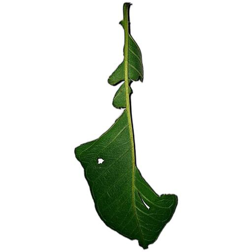
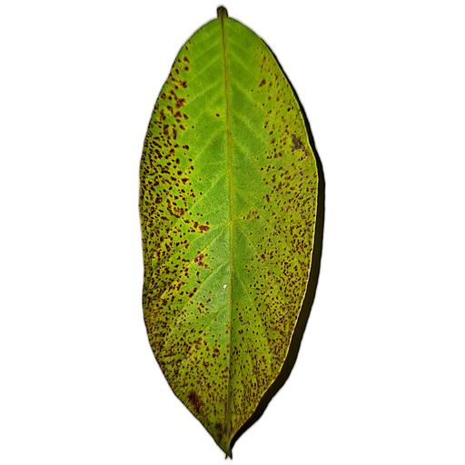
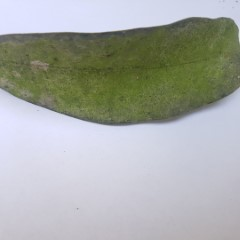
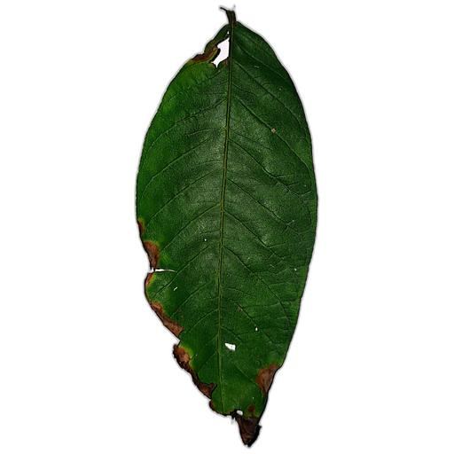
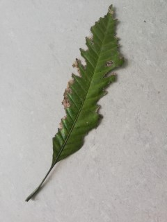

# Patch Lineage & Dataset Curation Audit (`docs/PATCH_LINEAGE.md`)

> [!IMPORTANT]
> This document records the empirical lineage of dataset curation patches applied to `plant-disease-backend`. All counts and split allocations are computed directly from patch execution move logs, plan manifests (`data/patches/*_PLAN.csv`, `P-005_move_log.csv`), and verification reports (`reports/v1/*`).
> If numbers differ between documents, this file and reports/v1/results.json are authoritative.

---

## 1. Master Patch Lineage Table

| Patch | Date | Action | Files Moved | Classes After | Images After | Train / Val / Test After |
|:---|:---:|:---|:---:|:---:|:---:|:---:|
| **Pre-P-001 Baseline** | Historical (pre-Oct 2026) | Ingestion baseline across open-source repositories (`reports/history/v0_ratio_audit.csv`) | 0 | 198 | 99,748 | 78,952 / 10,338 / 10,458 |
| **P-001** | 2026-10-25 | Quarantined duplicate Mendeley Bell Pepper images overlapping with Chilli (de-listed 3 classes) | 253 quarantined | 195 | 99,495 | 78,756 / 10,312 / 10,427 (196 train / 26 val / 31 test quarantined) |
| **P-002** | 2026-10-25 | Stratified repartitioning for Citrus Greening & Soybean Healthy (net train +2, val -1, test -1) | 404 rebalanced (0 quarantined) | 195 | 99,495 | 78,758 / 10,311 / 10,426 (matches `reports/history/dataset_v0_manifest_198class.csv`) |
| **P-003** | 2026-10-30 | Quarantined 0-bit perceptual hash cross-split twin frames across splits | 1,415 quarantined | 195 | 98,080 | 78,758 / 9,664 / 9,658 (0 train / 647 val / 768 test quarantined) |
| **P-004** | 2026-10-31 | Quarantined cross-split duplicates (304) and contradictory labels (941) | 1,245 quarantined | 195 | 96,835 (on-disk active: 96,830) | 78,187 / 9,321 / 9,327 (on-disk: 78,185 / 9,320 / 9,325) |
| **P-005** | 2026-11-05 | Foliar pathology curation: quarantined non-foliar/outliers (4,665), relabeled (3,062), merged (498) | 8,225 moves | 177 (33 crops) | 92,165 | 74,507 / 8,822 / 8,836 (3,678 train / 498 val / 489 test quarantined; 0 split changes) |
| **P-006** | 2026-11-06 | Stratified 80/10/10 split rebalancing across 21 imbalanced classes (seed 42, min val/test $\ge 3$) | 1,986 repartitioned (0 quarantined) | 177 (33 crops) | 92,165 (0 net change) | 73,356 / 9,349 / 9,460 (-1,151 train / +527 val / +624 test) |
| **P-007** | 2026-11-18 | Quarantined 181 near-duplicate test leakage frames into `data/raw/quarantine_test_leakage_twins/test/` | 181 quarantined | 177 (33 crops) | 91,984 | 73,356 / 9,349 / 9,279 (0 train / 0 val / 181 test quarantined) |

### Transition from 198 to 195 Classes (Patch P-001)
The transition from 198 classes to 195 classes in Patch P-001 was caused by the de-listing and quarantining of exactly 3 Bell Pepper classes:
1. `Bell Pepper - Leaf Curl Virus` (125 images: 98 train, 15 val, 12 test)
2. `Bell Pepper - Nutrition Deficiency` (71 images: 54 train, 6 val, 11 test)
3. `Bell Pepper - bell pepper powdery mildew` (57 images: 44 train, 5 val, 8 test)

Under Decision 59 / ADR-035, an ingestion audit of Mendeley dataset `w9drvtxg9g.1` revealed that these 3 Bell Pepper classes contained photographic specimens that were identical duplicates and impostors of images in the Chilli dataset. All 253 active frames across these 3 classes (196 train, 26 val, 31 test) were quarantined into `data/raw/quarantine_bell_pepper_chilli_overlap/` to eliminate cross-crop taxonomic contamination.

### P-001 and P-002 Per-Split Lineage & Manifest Derivation

- **Pre-P-001 Baseline (198 classes, 99,748 images):** Ground truth documented in `reports/history/v0_ratio_audit.csv` with exactly **78,952 train / 10,338 val / 10,458 test** images across 198 classes.
- **Patch P-001 (Executed 2026-10-25 via `data/patches/history/P-001_PLAN.csv`):** Quarantined 253 duplicate Mendeley Bell Pepper images (196 train, 26 val, 31 test) across the 3 de-listed classes above into `data/raw/quarantine_bell_pepper_chilli_overlap/`. Post-P-001 active split counts were **78,756 train / 10,312 val / 10,427 test** (total 99,495 images, 195 classes).
- **Patch P-002 (Executed 2026-10-25 via `data/patches/history/P-002_PLAN.csv`):** Rebalanced 404 images across Citrus greening (227) and Soybean healthy (177) with 0 quarantined. Move directions: train $\to$ test (105), train $\to$ val (96), val $\to$ train (97), test $\to$ train (106). Net split impact: Train $+2$, Val $-1$, Test $-1$ (net total = 0). Post-P-002 active split counts were **78,758 train / 10,311 val / 10,426 test** (total 99,495 images, 195 classes). This post-P-002 state matches the manifest `reports/history/dataset_v0_manifest_198class.csv` (which records post-P-002 active files, verified by 404/404 P-002 images matching their destination splits).
- **Patch P-005 Category Breakdown:** 8,225 physical moves: Category A relabels (3,062: 2,540 train / 270 val / 252 test), Category B mergers (498: 398 train / 50 val / 50 test), Category C pathology quarantines (4,662: 3,677 train / 496 val / 489 test), and Category D outlier quarantines (3: 1 train [Ginger noise `img_00038551.jpg`], 2 val [Ginger wheat leaf `img_00044166.jpg`, Jamun outlier `jamun_bacterial_spot_val_0038.jpg`], 0 test). Total quarantined across C and D is 4,665 (3,678 train / 498 val / 489 test). Zero moves changed split between source and destination. *(See [Section 3: Patch P-005: Deep Botanical Curation Dossier](#3-patch-p-005-deep-botanical-curation-dossier-5-relabels-1-merge-17-quarantined-classes-3-outlier-images--195-to-177-classes) for detailed botanical rationales and image evidence).*

### Resolution of the 95,420 Discrepancy
Earlier preliminary documentation incorrectly listed "95,420 images after P-003". This figure arose from an erroneous backwards subtraction where the P-003 quarantine count (1,415) was subtracted from the post-P-004 catalog count:
$$96,835 - 1,415 = 95,420$$
Chronologically, Patch P-003 was executed on October 30, 2026, removing 1,415 frames from 99,495 active images, which resulted in **98,080 active images** (test split $N=9,658$). Patch P-004 was subsequently executed on October 31, 2026, removing 1,245 frames from 98,080 active images, resulting in **96,835 catalog images** ($98,080 - 1,245 = 96,835$, corresponding to 96,830 on-disk active files).

---

## 2. Definitions: Exact Duplicates vs. Perceptual Twin Pairs

- **Exact SHA-256 Duplicate:** Two identical photographic files sharing the exact same cryptographic hash ($d=0$ byte difference). There are 0 cross-split exact SHA-256 duplicates in Dataset v1.0 (`reports/v1/twin_check.json`, `exact_sha256_duplicates.total_duplicate_sets: 0`).
- **Perceptual Hash Near-Duplicate Twin Pair:** Two photographic files whose 64-bit DCT perceptual hash (`pHash`) has a Hamming distance $d \le 4$. This captures bursts, identical physical leaves captured with camera jitter, slight recompressions, or unstratified multi-angle captures.
- **Pairs Touching Test Split (312 pairs across 181 test images: 282 test-train + 30 test-val):** Prior to Patch P-007, near-duplicate cross-split leakage touched the test split through **312 pairs**: 282 pairs connecting test images to training counterparts, plus 30 pairs connecting test images to validation counterparts. Because individual leaves participate in multi-image capture bursts (e.g., 1 training image matching 2 test frames), these 312 pairs spanned exactly **181 unique test images**.
- **Pairs Connecting Validation Split to Train (260 pairs across 162 validation images):** The validation split contains **260 train-val twin pairs** (145 exact $d=0$ pHash pairs + 115 near-duplicate $d \in [1,4]$ pairs; `reports/v1/twin_check.json`). These 260 pairs span exactly **162 unique validation images** (itemized in `reports/v1/p008_plan_DRYRUN.csv`).
- **Total Unique Evaluation Images Affected (343):** Combining both evaluation partitions yields exactly **343 unique evaluation images** ($181\text{ test} + 162\text{ validation} = 343$; archived in `data/patches/history/leaky_eval_images_historical_343.csv`).
- **P-006 Origin of Validation Twins:** 161 of the 162 validation twin images (**99.4%**) belong to the 21 classes repartitioned by Patch P-006 (such as Jamun and Paddy classes that were completely absent from validation prior to P-006). Exactly 1 image (`data/processed/val/Guava - Dot/mendeley_guava_dot_val_0019.jpg`) belongs to a class not touched by P-006 and thus predated P-006.
- **Post-P-007 State:** Patch P-007 physically quarantined all 181 test leakage frames (`reports/v1/removed_p007_images.csv`), reducing `train_vs_test` and `val_vs_test` twin pairs to **0**. The remaining cross-split pairs reside strictly between train and val (260 pairs across 162 validation images).

---

## 3. Patch P-005: Deep Botanical Curation Dossier (5 Relabels, 1 Merge, 17 Quarantined Classes, 3 Outlier Images — 195 to 177 Classes)

**Status:** EXECUTED & VERIFIED (Applied November 5, 2026 via `scripts/data/apply_patch_p005.py --execute`)  
**Parent Release:** Pre-release Baseline (Model v1.0-pre / Dataset v1.0-pre, 195 classes, 96,835 images)  
**Target Release:** Official Launch Release v1.0 (Model v1.0 / Dataset v1.0, 177 classes, 91,984 images post-P-007)  
**Evidence Images:** 23 files: 5 published (verified permissive CC BY 4.0 / CC0 1.0), 17 placeholders (*"Evidence image available on request (source licence not verified)"*), and 1 orphan file untracked.  

### 3.1 Executive Summary
During the systematic manual visual review of all 34 crops and 195 classes in `plant-disease-backend` (Dataset v1.0, $N=96,835$), 24 distinct pathology anomalies were identified. These anomalies stem from historical open-source dataset ingestion errors (PlantCity, Mendeley, Kaggle, legacy PlantVillage baseline) and fall into four primary categories:

1. **Biological Misidentifications & Label Realignment (5 Classes, 3,062 Images):** Diseases mislabeled at the pathogen level (e.g. physiological potassium deficiency mislabeled as Alternaria; parasitic alga mislabeled as fungal rust; spider mite damage mislabeled as fungal scab).
2. **Taxonomic Mergers (1 Class, 498 Images):** Folder partitions containing visually and pathologically identical manifestations of the same foliar disease (Mango Powdery Mildew and Sooty Mould both containing Sooty Mould foliage).
3. **Non-Foliar, Ambiguous & Contaminated Class Quarantines (17 Classes across 6 Crops + 1 Entire Crop, 4,662 Images):** Fruit-only pathology (Guava Mummification), non-foliar/sheath images (Ginger Sheath Blight), root/soil nematode pests (Potato Cyst Nematode), non-specific umbrella labels (Potato Fungal Diseases), severe non-foliar chlorosis/shot leaves (Zucchini 4 classes), inter-crop morphological impostors (Fig leaves showing Vitis vinifera grape leaf morphology), plus Apple alternaria (422 images) and Eggplant Cercospora (199 images) added during audit expansion.
4. **Individual Outlier & Cross-Species Leaf Contaminations (3 Active Images on Disk):** Stray monocot leaves (wheat leaf in ginger folder), severe noise, and isolated non-representative frames.

**Review Methodology:** High-resolution visual inspection conducted using the interactive dataset inspector tool, comparing symptoms against standardized phytopathology compendia (APS Plant Disease Compendia series, CABI Crop Protection Compendium) and authoritative herbarium type specimens.

### 3.2 Summary Statistics of Executed Patch P-005

| Category | Classes Affected | Train | Val | Test | Total Images |
| :--- | :---: | :---: | :---: | :---: | :---: |
| **Category A: Label Realignments** | 5 | 2,540 | 270 | 252 | **3,062** |
| **Category B: Class Mergers** | 1 | 398 | 50 | 50 | **498** |
| **Category C: Bulk Class / Crop Quarantines** | 17 classes + 1 crop | 3,677 | 496 | 489 | **4,662** |
| **Category D: Individual Image Removals** | 3 classes | 1 | 2 | 0 | **3** *(active on disk)* |
| **Total Images Re-categorized or Quarantined** | — | **6,616** | **818** | **791** | **8,225** |

*(Note: Category C reflects 4,662 bulk images, including Apple alternaria [422] and Eggplant Cercospora [199] added during audit expansion. Total quarantined across Categories C and D is 4,665 images: 3,678 train / 498 val / 489 test).*

### 3.3 Category A: Biological Realignments & Label Corrections

#### Case A-1: `Citrus - citrus scab` $\rightarrow$ `Citrus - Citrus Hindu mite`
- **Current Folder:** `Citrus - citrus scab` (65 images: 51 train / 6 val / 8 test)
- **Source Dataset:** `plantcity` (100%)
- **Pathological Diagnosis:** *Schizotetranychus hindustanicus* (Citrus Hindu mite). Leaves display characteristic uniform chlorotic stippling, circular silken nesting webs, and pale necrotic specks characteristic of spider mite feeding, completely lacking the raised, corky, wart-like pustules of true Citrus Scab (*Elsinoë fawcettii*).
- **Applied Label:** `Citrus - Citrus Hindu mite`
  - **Visual Evidence Asset:** docs/assets/placeholder.svg (Evidence image available on request; source licence not verified)
  
  *Evidence image available on request (source licence not verified).*

#### Case A-2: `Citrus - Black spot` $\rightarrow$ `Citrus - Alternaria leaf spot`
- **Current Folder:** `Citrus - Black spot` (123 active images on disk: 99 train / 12 val / 12 test)
- **Source Dataset:** `sourabh2001` (100%)
- **Pathological Diagnosis:** *Alternaria alternata pv. citri* (Citrus Alternaria Brown Spot / Leaf Spot). Visual examination assessed by the author through visual review diagnosed the foliar lesions as Alternaria brown spot rather than anthracnose or true black spot. Leaves present circular dark necrotic spots surrounded by prominent chlorotic yellow halos caused by Alternaria ACT-toxin diffusion. True Citrus Black Spot (*Phyllosticta citricarpa*) produces tiny elevated, crater-like hard spots without diffuse halos.
- **Applied Label:** `Citrus - Alternaria leaf spot`
  - **Visual Evidence Asset:** docs/assets/placeholder.svg (Evidence image available on request; source licence not verified)
  
  *Evidence image available on request (source licence not verified).*

#### Case A-3: `Guava - Anthracnose` $\rightarrow$ `Guava - Insect Damage`
- **Current Folder:** `Guava - Anthracnose` (691 images: 624 train / 44 val / 23 test)
- **Source Dataset:** `mendeley_guava` (100%)
- **Pathological Diagnosis:** Foliar Chewing Pest / Insect Injury. Visual examination reveals mechanical perforation, irregular holes chewed through the lamina, margin tearing, and missing foliar tissue, rather than fungal necrosis or *Colletotrichum* anthracnose lesion rings.
- **Applied Label:** `Guava - Insect Damage`
- **Visual Evidence Asset:** `docs/assets/p005/guava_insect_damage_evidence.jpg`
  
  *Source Dataset: Guava foliar disease dataset from Bangladesh (Mendeley Data), License: CC BY 4.0, Modifications: Resized to max 800x600 JPEG.*

#### Case A-4: `Guava - Rust` $\rightarrow$ `Guava - Algal Leaf Spot`
- **Current Folder:** `Guava - Rust` (1,072 images: 905 train / 84 val / 83 test)
- **Source Dataset:** `mendeley_guava` (100%)
- **Pathological Diagnosis:** *Cephaleuros virescens* (Algal Leaf Spot, commonly called Red Rust). Colonies present as velvety, circular, orange-brown cushion-like algal thalli elevated on the upper foliar surface, caused by a parasitic green alga, distinct from true fungal basidiomycete rust (*Puccinia psidii*).
- **Applied Label:** `Guava - Algal Leaf Spot`
- **Visual Evidence Asset:** `docs/assets/p005/guava_algal_leaf_spot_evidence.jpg`
  
  *Source Dataset: Guava foliar disease dataset from Bangladesh (Mendeley Data), License: CC BY 4.0, Modifications: Resized to max 800x600 JPEG.*

#### Case A-5: `Groundnut - Early rust` $\rightarrow$ `Groundnut - Late leaf spot and early rust`
- **Current Folder:** `Groundnut - Early rust` (1,111 images: 861 train / 124 val / 126 test)
- **Source Dataset:** `groundnut_kaggle` (100%)
- **Pathological Diagnosis:** Foliar Disease Complex (*Phaeoisariopsis personata* + *Puccinia arachidis*). Groundnut foliage consistently displays co-infection consisting of dark circular late leaf spot lesions surrounded by chlorotic halos alongside orange-brown rust pustules on the abaxial surface.
- **Applied Label:** `Groundnut - Late leaf spot and early rust`
  - **Visual Evidence Asset:** docs/assets/placeholder.svg (Evidence image available on request; source licence not verified)
  
  *Evidence image available on request (source licence not verified).*

### 3.4 Category B: Class Mergers

#### Case B-1: `Mango - Powdery Mildew` $\rightarrow$ Merge into `Mango - Sooty Mould`
- **Source Folders:**
  - `Mango - Powdery Mildew` (498 images: 398 train / 50 val / 50 test)
  - `Mango - Sooty Mould` (499 images: 400 train / 49 val / 50 test)
- **Source Dataset:** `mango_mendeley` (100%)
- **Pathological Diagnosis:** Both folders contain distinct images of black velvety superficial fungal coatings (*Capnodium mangiferae* / Sooty Mould) growing on insect honeydew. Neither folder depicts the white powdery epiphytic conidia of true Powdery Mildew (*Oidium mangiferae*).
- **Duplicate Verification:** Exact hash intersection between both folders is 0. Merging creates a unified class with 997 distinct sooty mold images.
- **Applied Action:** Merge all images into `Mango - Sooty Mould` (Total: 798 train / 99 val / 100 test = 997).
- **Visual Evidence Asset:** `docs/assets/p005/mango_sooty_mold_in_powdery_folder.jpg`
  
  *Source Dataset: Mango Leaf Disease Dataset (Mendeley Data), License: CC0 1.0 (Public Domain), Modifications: Resized to max 800x600 JPEG.*

### 3.5 Category C: Non-Foliar, Ambiguous & Contaminated Quarantines

#### Case C-1: `Guava - Mummification` (Quarantine Entire Class)
- **Images:** 273 (219 train / 26 val / 28 test) | Source: `paddy_doctor_kaggle`
- **Reason:** Depicts dried, shriveled, blackened fruit mummification. Violates the foliar classification remit of the backend.
  - **Visual Evidence Asset:** docs/assets/placeholder.svg (Evidence image available on request; source licence not verified)
  
  *Evidence image available on request (source licence not verified).*

#### Case C-2: `Guava - Canker` (Quarantine Entire Class)
- **Images:** 1,126 (915 train / 103 val / 108 test) | Source: `mendeley_guava`
- **Reason:** Fruit canker lesions and twig dieback with high visual noise and label ambiguity.
- **Visual Evidence Asset:** `docs/assets/p005/guava_canker_noise_evidence.jpg`
  
  *Source Dataset: Guava foliar disease dataset from Bangladesh (Mendeley Data), License: CC BY 4.0, Modifications: Resized to max 800x600 JPEG.*

#### Case C-3: `Fig` — All 4 Classes (Quarantine Entire Crop)
- **Images:** 829 (638 train / 98 val / 93 test across 4 classes) | Source: `plantcity`
- **Reason:** Palmate, deeply-lobed serrated leaves strongly indicate *Vitis vinifera* (Grape) foliage misfiled under Fig (*Ficus carica*). Entire crop quarantined pending genetic/botanical verification.
  - **Visual Evidence Asset:** docs/assets/placeholder.svg (Evidence image available on request; source licence not verified)
  
  *Evidence image available on request (source licence not verified).*

#### Case C-4: `Ginger - ginger sheath blight` (Quarantine Entire Class)
- **Images:** 65 (52 train / 7 val / 6 test) | Source: `Master Plant Disease Dataset (plantseg component; Tanniru, 2025)`
- **Pathological & Forensic Audit:** Visual examination reveals severe cross-species contamination and absence of clean foliar ginger leaves:
  1. **Corn (*Zea mays*) Contamination:** Specimen depicts a corn stalk, leaf collar, and developing ear with banded sheath blight lesions.
  2. **Paddy Rice (*Oryza sativa*) Contamination:** Specimen depicts flooded paddy rice hills in standing water displaying rice sheath blight / foliar lesions.
  3. **Folder-Wide Absence of Foliar Leaves:** Comprehensive folder thumbnail inspection demonstrates that the remaining images consist almost entirely of dug-up root crowns, washed pseudostem sheaths, and severed stalks rather than flat foliar lamina.
- **Applied Action:** Drop and quarantine the entire class (`data/raw/quarantine_ginger_sheath_blight/`).
- **Visual Evidence Assets:**
  - **Asset 1 (Corn Ear/Stalk Impostor):** `docs/assets/p005/ginger_sheath_blight_corn_contamination.jpg`  
  
  *Evidence image available on request (source licence not verified).*
  - **Asset 2 (Paddy Rice Canopy Impostor):** `docs/assets/p005/ginger_sheath_blight_paddy_contamination.jpg`  
  
  *Evidence image available on request (source licence not verified).*
  - **Asset 3 (Full Folder Thumbnail Audit):** `docs/assets/p005/ginger_sheath_blight_folder_grid_screenshot.jpg`  
  
  *Evidence image available on request (source licence not verified).*

#### Case C-5: `Mango - Bacterial Canker` (Quarantine Entire Class)
- **Images:** 497 (398 train / 50 val / 49 test) | Source: `mango_mendeley`
- **Reason:** Foliar symptoms are non-specific and unidentifiable; cannot be differentiated reliably from abiotic leaf stress.
- **Visual Evidence Asset:** `docs/assets/p005/mango_bacterial_canker_evidence.jpg`
  
  *Source Dataset: Mango Leaf Disease Dataset (Mendeley Data), License: CC0 1.0 (Public Domain), Modifications: Resized to max 800x600 JPEG.*

#### Case C-6: `Potato - fungal diseases` (Quarantine Entire Class)
- **Images:** 398 (318 train / 39 val / 41 test) | Source: `potato_kaggle`
- **Reason:** Ambiguous umbrella category that creates non-specific taxonomic overlap with established classes (`Potato - Early Blight` and `Potato - Late Blight`).
  - **Visual Evidence Asset:** docs/assets/placeholder.svg (Evidence image available on request; source licence not verified)
  
  *Evidence image available on request (source licence not verified).*

#### Case C-7: `Potato - potato cyst nematode` (Quarantine Entire Class)
- **Images:** 237 (188 train / 25 val / 24 test) | Source: `potato_kaggle`
- **Reason:** *Globodera spp.* is a subterranean soil/root-infecting endoparasite. Foliar symptoms are non-specific stunting/yellowing; invalid for foliar classification.
  - **Visual Evidence Asset:** docs/assets/placeholder.svg (Evidence image available on request; source licence not verified)
  
  *Evidence image available on request (source licence not verified).*

#### Case C-8: `Radish - Mosaic` (Quarantine Entire Class)
- **Images:** 372 (285 train / 45 val / 42 test) | Source: `Master Plant Disease Dataset (Mendeley Data Multi-Crop component; Prem Kumar E., 2025)`
- **Reason:** Foliar symptoms exhibit angular chlorosis resembling Downy Mildew rather than viral mosaic; unconfirmed pathology warrants conservative quarantine.
  - **Visual Evidence Asset:** docs/assets/placeholder.svg (Evidence image available on request; source licence not verified)
  
  *Evidence image available on request (source licence not verified).*

#### Case C-9: `Zucchini` — 4 Noisy Classes (Quarantine 4 Classes)
- **Affected Classes:**
  - `Zucchini - zucchini angular leaf spot` (77 images: 61 train / 8 val / 8 test)
  - `Zucchini - zucchini anthracnose` (45 images: 37 train / 4 val / 4 test)
  - `Zucchini - zucchini bacterial leaf spot` (21 images: 17 train / 2 val / 2 test)
  - `Zucchini - zucchini downy mildew` (101 images: 79 train / 10 val / 12 test)
- **Total Quarantined:** 244 images (194 train / 24 val / 26 test) | Source: `agrivision_zucchini` + `Master Plant Disease Dataset (plantseg component)`
- **Reason:** Severe generalized chlorosis, mechanical shot leaves, and heavy mutual confusion (F1 scores between 0.50 and 0.66) showing inadequate feature discriminability.
- **Visual Evidence Assets:**
  - `docs/assets/p005/zucchini_angular_yellow_evidence.jpg`
  
  *Evidence image available on request (source licence not verified).*
  - `docs/assets/p005/zucchini_downy_mildew_evidence.jpg`
  
  *Evidence image available on request (source licence not verified).*

#### Case C-10: `Eggplant - Cercospora Leaf Spot` (Quarantine Entire Class)
- **Images:** 199 (159 train / 20 val / 20 test) | Source: `eggplant_kaggle`
- **Pathological & Forensic Audit:** Detailed visual and forensic thumbnail inspection of `data/processed/train/Eggplant - Cercospora Leaf Spot` reveals severe intra-folder heterogeneity:
  1. **Yellow Mosaic Virus Sub-population:** Multiple early frames display distinct bright yellow chlorotic mottling, blistering, and vein-banding characteristic of Eggplant Yellow Mosaic Virus (assessed by the author through visual review).
  2. **Abiotic Marginal Chlorosis / Senescence:** Other frames exhibit physiological leaf tip yellowing and senescence.
  3. **Mechanical / Pest Shot Holes:** Multiple specimens exhibit ragged holes lacking fungal sporulation.
  4. **Asymptomatic Leaves:** Several frames show plain healthy foliage.
  5. **Total Absence of Cercospora:** Classical *Cercospora melongenae* circular spots with grayish-white centers and purple margins are completely absent.
- **Applied Action:** Drop and quarantine the entire class (`data/raw/quarantine_eggplant_cercospora_mixed/`) to prevent multi-disease gradient contamination.
  - **Visual Evidence Asset:** docs/assets/placeholder.svg (Evidence image available on request; source licence not verified)
  
  *Evidence image available on request (source licence not verified).*

#### Case C-11: `Apple - apple alternaria leaf spot` (Quarantine Entire Class)
- **Images:** 422 (311 train / 59 val / 52 test) | Source: `plantcity`
- **Pathological Diagnosis:** Unresolved: sectoral chlorophyll deficiency and marginal necrosis, consistent with genetic variegation or a nutrient deficiency; inconsistent with fungal Alternaria leaf blotch (*Alternaria mali*). As a non-pathological, non-communicable genetic abnormality specific to a single cultivated specimen (assessed by the author through visual review), retaining this class as an agricultural disease label creates severe real-world false alarms.
- **Applied Action:** Drop and quarantine the entire class (`data/raw/quarantine_apple_genetic_anomaly/`).
  - **Visual Evidence Asset:** docs/assets/placeholder.svg (Evidence image available on request; source licence not verified)
  
  *Evidence image available on request (source licence not verified).*

### 3.6 Category D: Individual Outlier & Cross-Species Leaf Contaminations

| Image Path | Split | Hash (SHA-256) | Reason | Evidence Asset |
| :--- | :---: | :--- | :--- | :--- |
| `data/processed/val/Ginger - ginger leaf spot/img_00044166.jpg` | Val | `98089e532887258cce7933b90fb2707cf9dab044fb6651f390804b9948da6049` | Monocot wheat leaf contamination | `docs/assets/placeholder.svg (available on request)` |
| `data/processed/val/Jamun - Bacterial Spot/jamun_bacterial_spot_val_0038.jpg` | Val | `accb1d0ff66c420a42b35fda0084a4f3ca8ddb028de7821fe69279d6d74deeb4` | Non-representative outlier frame | `docs/assets/placeholder.svg (available on request)` |
| `data/processed/train/Ginger - ginger leaf spot/img_00038551.jpg` | Train | `ae70ff09e5bf4d7336087d6167b4b3875566e509da0315fb802907d78c147b93` | Non-disease visual noise | Stored in scratch registry |

### 3.7 Master Patch P-005 Inventory Table

| Patch Ref | Target Class / Folder | Action | Train | Val | Test | Total | Target Quarantine / Applied Label |
| :---: | :--- | :--- | :---: | :---: | :---: | :---: | :--- |
| **P005-01** | `Citrus - citrus scab` | Relabel | 51 | 6 | 8 | 65 | `Citrus - Citrus Hindu mite` |
| **P005-02** | `Citrus - Black spot` | Relabel | 99 | 12 | 12 | 123 | `Citrus - Alternaria leaf spot` |
| **P005-03** | `Guava - Anthracnose` | Relabel | 624 | 44 | 23 | 691 | `Guava - Insect Damage` |
| **P005-04** | `Guava - Rust` | Relabel | 905 | 84 | 83 | 1,072 | `Guava - Algal Leaf Spot` |
| **P005-05** | `Groundnut - Early rust` | Relabel | 861 | 124 | 126 | 1,111 | `Groundnut - Late leaf spot and early rust` |
| **P005-06** | `Apple - apple alternaria leaf spot` | Quarantine | 311 | 59 | 52 | 422 | `data/raw/quarantine_apple_genetic_anomaly/` |
| **P005-07** | `Guava - Mummification` | Quarantine | 219 | 26 | 28 | 273 | `data/raw/quarantine_non_foliar/` |
| **P005-08** | `Guava - Canker` | Quarantine | 915 | 103 | 108 | 1,126 | `data/raw/quarantine_guava_canker_noise/` |
| **P005-09** | `Fig` (All 4 Classes) | Quarantine | 638 | 98 | 93 | 829 | `data/raw/quarantine_fig_crop/` |
| **P005-10** | `Ginger - ginger sheath blight` | Quarantine | 52 | 7 | 6 | 65 | `data/raw/quarantine_ginger_sheath_blight/` |
| **P005-11** | `Ginger - leaf spot/img_00038551.jpg` | Remove | 1 | 0 | 0 | 1 | `data/raw/quarantine_outliers/` |
| **P005-12** | `Ginger - leaf spot/img_00044166.jpg` | Remove | 0 | 1 | 0 | 1 | `data/raw/quarantine_outliers/` |
| **P005-13** | `Jamun - Bacterial Spot/...0038.jpg` | Remove | 0 | 1 | 0 | 1 | `data/raw/quarantine_outliers/` |
| **P005-14** | `Mango - Bacterial Canker` | Quarantine | 398 | 50 | 49 | 497 | `data/raw/quarantine_mango_canker/` |
| **P005-15** | `Mango - Powdery Mildew` | Merge | 398 | 50 | 50 | 498 | Merge into `Mango - Sooty Mould` |
| **P005-16** | `Potato - fungal diseases` | Quarantine | 318 | 39 | 41 | 398 | `data/raw/quarantine_potato_fungal/` |
| **P005-17** | `Potato - potato cyst nematode` | Quarantine | 188 | 25 | 24 | 237 | `data/raw/quarantine_potato_nematode/` |
| **P005-18** | `Radish - Mosaic` | Quarantine | 285 | 45 | 42 | 372 | `data/raw/quarantine_radish_mosaic/` |
| **P005-19** | `Zucchini - angular leaf spot` | Quarantine | 61 | 8 | 8 | 77 | `data/raw/quarantine_zucchini_noisy/` |
| **P005-20** | `Zucchini - anthracnose` | Quarantine | 37 | 4 | 4 | 45 | `data/raw/quarantine_zucchini_noisy/` |
| **P005-21** | `Zucchini - bacterial leaf spot` | Quarantine | 17 | 2 | 2 | 21 | `data/raw/quarantine_zucchini_noisy/` |
| **P005-22** | `Zucchini - downy mildew` | Quarantine | 79 | 10 | 12 | 101 | `data/raw/quarantine_zucchini_noisy/` |
| **P005-23** | `Eggplant - Cercospora Leaf Spot` | Quarantine | 159 | 20 | 20 | 199 | `data/raw/quarantine_eggplant_cercospora_mixed/` |
| **TOTAL** | — | — | **6,616** | **818** | **791** | **8,225** | — |

### 3.8 State After P-005

- **On-Disk Starting Baseline Before P-005:** 96,830 images (78,185 train / 9,320 val / 9,325 test)
- **Net Images Quarantined in P-005:** 4,665 images (4,662 bulk + 3 active outliers)
- **Active Dataset After P-005:** **92,165 images**
  - Train: 74,507
  - Val: 8,822
  - Test: 8,836
- **Class Count:** Reduced from 195 classes to **177 classes** across **33 crops** (net reduction of 18 classes: Fig crop dropped [4 classes], 13 classes quarantined, 1 class merged).

### 3.9 Unsupported Conditions After P-005

The following conditions were retired from the active taxonomy and quarantined during Patch P-005:
1. **Fruit and Dieback Pathologies:** `Guava - Mummification` (mummified fruit), `Guava - Canker` (fruit lesions and twig dieback).
2. **Subterranean Pests:** `Potato - potato cyst nematode` (*Globodera spp.* root cyst nematode).
3. **Non-Foliar Organs & Sheath Blight:** `Ginger - ginger sheath blight` (pseudostem/stalks contaminated with corn and paddy impostors).
4. **Morphological Impostor Crop:** `Fig` (all 4 classes showing *Vitis vinifera* grape leaf morphology).
5. **Non-Specific Umbrella & Low-Discriminability Classes:** `Potato - fungal diseases`, `Zucchini` (4 noisy chlorotic classes), `Eggplant - Cercospora Leaf Spot` (mixed viral mosaic and senescence), `Mango - Bacterial Canker` (non-specific abiotic stress overlap).
6. **Genetic Anomaly:** `Apple - apple alternaria leaf spot` (unresolved sectoral chlorophyll deficiency/genetic chimera variegation).

---

## 4. Known Consequence of Patch P-006

During Patch P-006 (executed November 6, 2026 via `data/patches/P-006_split_rebalance_PLAN.csv`), 1,986 images across 21 classes with severe class hoarding were repartitioned into 80% Train, 10% Val, and 10% Test allocations using random seed 42 to guarantee $\ge 3$ images per split.

### Move Direction Breakdown & Net Gain Analysis
The 1,986 physical moves in `P-006_split_rebalance_PLAN.csv` break down by direction as follows:
- `train -> test`: 774 files
- `train -> val`: 768 files
  *(Total moved out of train: 1,542 files)*
- `val -> train`: 240 files
- `val -> test`: 27 files
  *(Total moved out of val: 267 files)*
- `test -> train`: 151 files
- `test -> val`: 26 files
  *(Total moved out of test: 177 files)*
- **Total Physical Moves:** $1,542 + 267 + 177 = \mathbf{1,986\text{ files moved}}$.

**Net Changes by Split:**
- **Train Net Change:** $391\text{ (in)} - 1,542\text{ (out)} = \mathbf{-1,151\text{ files}}$
- **Val Net Change:** $794\text{ (in)} - 267\text{ (out)} = \mathbf{+527\text{ files}}$
- **Test Net Change:** $801\text{ (in)} - 177\text{ (out)} = \mathbf{+624\text{ files}}$
- **Evaluation Net Gain (Val + Test):** $+527 + 624 = \mathbf{+1,151\text{ files}}$
- **Total Dataset Net Change:** $-1,151 + 527 + 624 = \mathbf{0}$ (active images remained 92,165).

**Explanation:** 1,986 moves were executed while net gain for val + test was 1,151 because repartitioning required bidirectional balancing: 1,542 files were shifted out of over-represented training classes into val and test, 391 files were shifted from val/test back into train (151 test $\to$ train, 240 val $\to$ train) to maintain class ratio constraints, and 53 files moved between evaluation splits ($27\text{ val}\to\text{test}, 26\text{ test}\to\text{val}$).

### Near-Duplicate Consequences & P-007 Quarantine
No twin clustering or perceptual similarity grouping was used during P-006 repartitioning. As a direct consequence, near-duplicate twin frames crossed split boundaries:
- **343 evaluation images were affected** (162 in validation, 181 in test).
- **Physical Remediation in P-007:** Patch P-007 physically moved all 181 test leakage frames to quarantine, achieving a completely leak-free test split ($N=9,279$).
- **Measured Effect on Benchmark Accuracy:** The measured effect of filtering these 181 near-duplicate test twin images was a minor drop of 0.08 percentage points: **96.10% $\rightarrow$ 96.02%**.

---

## 5. Dataset Count Reconciliation (92,170 vs. 92,165 vs. 91,984)

A theoretical arithmetic calculation from earlier documentation suggested:
$$96,835\text{ (P-004 metadata)} - 4,665\text{ (P-005 quarantined)} = 92,170\text{ images}$$
$$92,170 - 181\text{ (P-007 quarantined)} = 91,989\text{ images}$$

However, the final verified active dataset count in Release v1.0 is **91,984 images** (a 5-image difference).

**Move Log & Filesystem Explanation:**
1. The 96,835 count originated from the post-P-004 metadata catalog manifest (`reports/prerelease/dataset_v1.csv` and `reports/v1/dataset_v1.summary.json`).
2. Prior to executing Patch P-005, an empirical disk audit verified that **5 images** were already absent from active processed folders:
   - `data/processed/train/Citrus - Black spot/sourabh_74.jpg` (train)
   - `data/processed/train/Citrus - Black spot/sourabh_78.jpg` (train)
   - `data/processed/val/Citrus - Black spot/sourabh_bl (4).png` (val)
   - `data/processed/test/Bean - bean halo blight/img_00043506.jpg` (test)
   - `data/processed/test/Paddy - Narrow Brown Spot/rice_lab_narrow_brown_val (77).jpg` (test)
3. The true on-disk starting baseline prior to P-005 was therefore **96,830 active files** (78,185 train / 9,320 val / 9,325 test), exactly matching the split breakdown ($78,187 - 2 = 78,185$ train, $9,321 - 1 = 9,320$ val, $9,327 - 2 = 9,325$ test).
4. Patch P-005 quarantined exactly 4,665 images on disk ($96,830 - 4,665 = \mathbf{92,165\text{ active images}}$), matching Training Snapshot S1 and Validation Snapshot S2 documented in `docs/DATASET_CARD.md`.
5. Patch P-006 repartitioned 1,986 images across splits with 0 net change to total images.
6. Patch P-007 quarantined exactly 181 test images on disk:
$$92,165 - 181 = \mathbf{91,984\text{ active images}}$$
7. This matches the official release manifest `reports/v1/dataset_v1.csv` (SHA-256: `9822de8f77e4a587...`) and physical filesystem counts across splits: Train 73,356 + Val 9,349 + Test 9,279 = **91,984**.

---

## 6. Residual Risks & Evaluation Limitations

The following known limitations apply to the active Model v1.0 and Dataset v1.0 benchmark:
1. **30 classes with <10 clean test images**: While every class has at least 1 test image, 30 classes have fewer than 10 clean test images (min 1, `Jamun - Bacterial Spot`), limiting per-class statistical confidence on rare categories.
2. **9 P-006 classes with clean test N<10**: Nine classes repartitioned by P-006 have clean test support $N < 10$ due to the post-hoc quarantine of near-duplicate frames.
3. **162 validation images still have near-duplicate twins in train**: 260 train-val twin pairs ($d \le 4$) remain between train and val affecting 162 unique validation images (`reports/v1/twin_check.json`). Remediation plan saved as a dry-run in `reports/v1/p008_plan_DRYRUN.csv` was NOT executed because it would reduce validation support for rare classes (e.g. Jamun - Bacterial Spot from 31 to 4 images); no class would drop below 3 (clean validation support ranges from 4 to 72 across all 13 affected classes). Validation results, temperature calibration and $\tau=0.60$ were computed with the 162 twins included. Sensitivity analysis (`reports/v1/val_twin_sensitivity.json`) shows that removing these 162 twins shifts $T_{\text{disease}}$ by only $+0.0001$ ($0.5013 \rightarrow 0.5014$), shifts $T_{\text{crop}}$ by $+0.0005$ ($0.5931 \rightarrow 0.5936$), changes validation coverage at $\tau=0.60$ by $0.06$ percentage points ($97.03\% \rightarrow 96.97\%$), and covered accuracy by $0.04$ percentage points ($97.25\% \rightarrow 97.21\%$). Evaluated on the held-out clean test split ($N=9,279$), refitted calibration yields identical soft-gated accuracy (96.03%), identical calibrated joint ECE (0.58%), and identical coverage (96.98%) and covered accuracy (97.52%) at $\tau=0.60$ (all deltas $\le 0.0001$).
4. **No independent field evaluation**: Benchmark numbers reflect held-out partitions sharing origins with training data. Real-world performance under diverse farm environments, illumination, and non-foliar visual noise is unverified.
5. **Label smoothing 0.05 is only a hypothesis for underconfidence**: Training-time regularization (`label_smoothing = 0.05`) is hypothesized to explain logit underconfidence, but other architectural and optimization factors may contribute.
6. **Serving confidence is the raw joint product**: In unconstrained mode, the reported confidence is the raw joint probability $P(\text{crop}) \times P(\text{disease} \mid \text{crop})$.

---

## 7. Training/Eval Overlap Check

### 7.1 Dataset Manifest Hashes, Commits, and Timestamps
The lineage stages governing Model v1.0 training, calibration, and test evaluation are:
- **Training Snapshot S1:** Base commit `2108689` (2026-11-06), MLflow run `cb46c7f8f10f45e59ad809720c7bccb6`, manifest SHA-256 `5b5bc90a052d10a4...`, containing 73,356 train / 9,349 val / 9,460 test images (92,165 total across 177 classes and 33 crops). Test images in S1 numbered 9,460; the 181 near-duplicate test twins were quarantined in P-007 and the weights were not retrained afterwards (weights_trained_on_release_snapshot: false), so all reported test metrics are on the purified N=9,279 split.
- **Val Checkpoint & Calibration Snapshot S2:** Commit `dbacd9c` (2026-11-15), manifest SHA-256 `5b5bc90a052d10a4...`. Temperature scaling parameters ($T_{\text{crop}} = 0.5931$, $T_{\text{disease}} = 0.5013$) and decision threshold $\tau = 0.60$ were fitted on the 9,349 validation images.
- **Clean Test Evaluation Snapshot S3:** Commit `3dcee03` (2026-11-18), held-out clean test folder ($N=9,279$).
- **Curated Release Snapshot S4:** Commit `781f8bd` (2026-11-18), manifest `reports/v1/dataset_v1.csv` (SHA-256: `9822de8f77e4a587...`), containing 73,356 train / 9,349 val / 9,279 test images (91,984 total).

### 7.2 Checkpoint Timestamps vs. Patches P-006 and P-007
- **Patch P-006** was executed on **November 6, 2026** (`data/patches/P-006_split_rebalance_PLAN.csv`), repartitioning 1,986 images across 21 classes to establish the 73,356 train / 9,349 val / 9,460 test distribution.
- **Training Snapshot S1 already incorporated Patch P-006.** The model weights (`3bb5785efa957a5fd4eb9d071fa92ff57adbef9788275a810e9cce99cf016dcb`) were trained on November 6, 2026 on this post-P-006 training split (73,356 images).
- **Calibration** was fitted on **November 15, 2026** on Snapshot S2 validation split (9,349 images).
- **Patch P-007** was executed on **November 18, 2026** (`data/patches/P-007_test_leakage_quarantine_PLAN.csv`), physically quarantining 181 near-duplicate test leakage frames into `data/raw/quarantine_test_leakage_twins/test/`. Model weights were not retrained post-P-007 (`weights_trained_on_release_snapshot: false`).

### 7.3 Exact Byte-Level Split Disjointness (SHA-256) and Perceptual Twin Status
The exact SHA-256 cryptographic byte-level hash intersection between the training-run training partition (73,356 images) and current evaluation partitions is exactly **0**:
- **Train vs. Validation exact SHA-256 intersection:** **0**
- **Train vs. Test exact SHA-256 intersection:** **0**
- **Validation vs. Test exact SHA-256 intersection:** **0**
Verified via `reports/v1/twin_check.json` (`exact_sha256_duplicates.total_duplicate_sets: 0`). Zero images in the evaluation splits share identical bytes with any training image. This check covers byte-identical files only. Perceptual near-duplicates (pHash d <= 4) are tracked separately: 0 between train and test, 0 between val and test, and 260 train-val pairs across 162 validation images remain (see Section 6, item 3).
