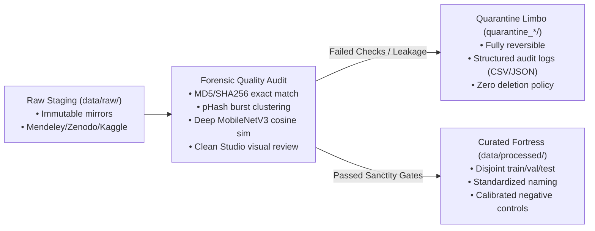
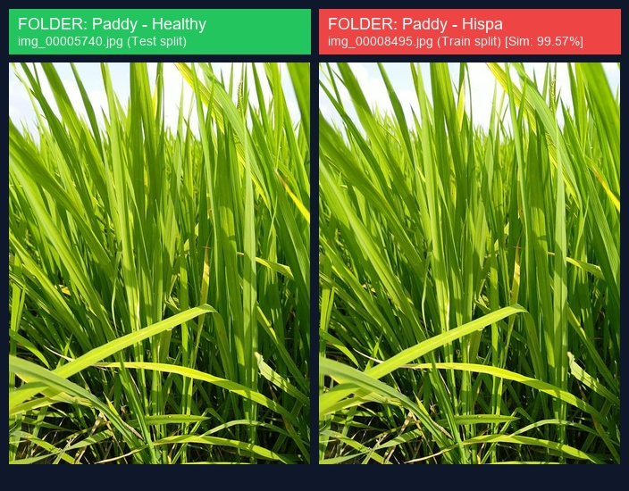
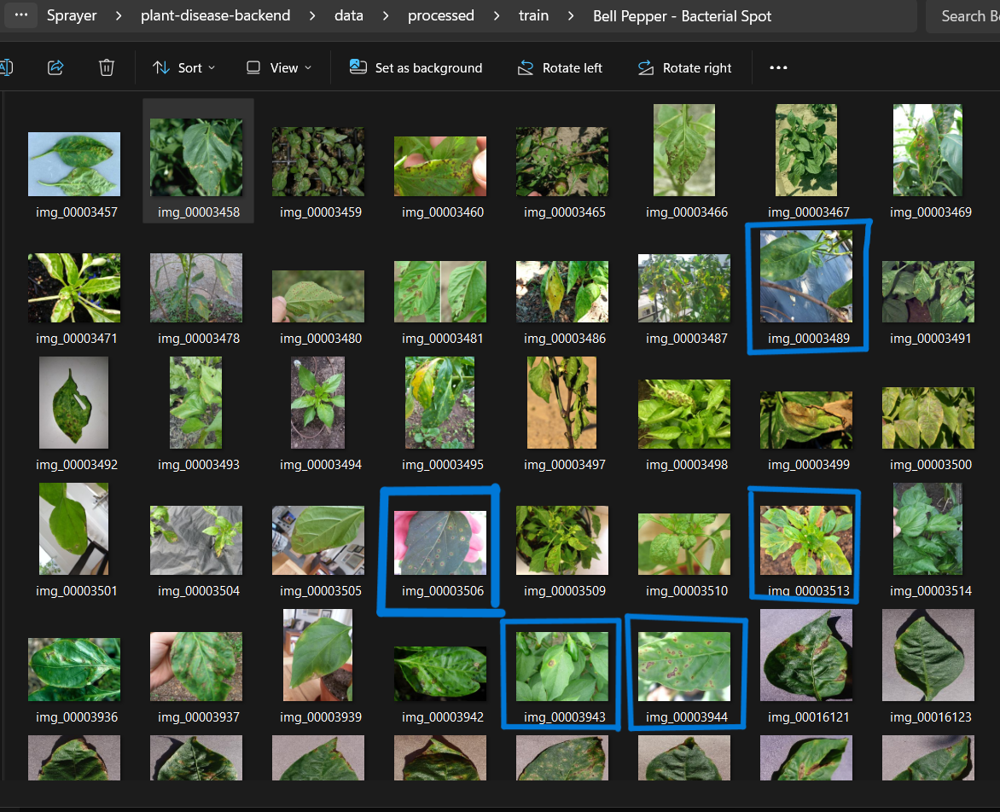
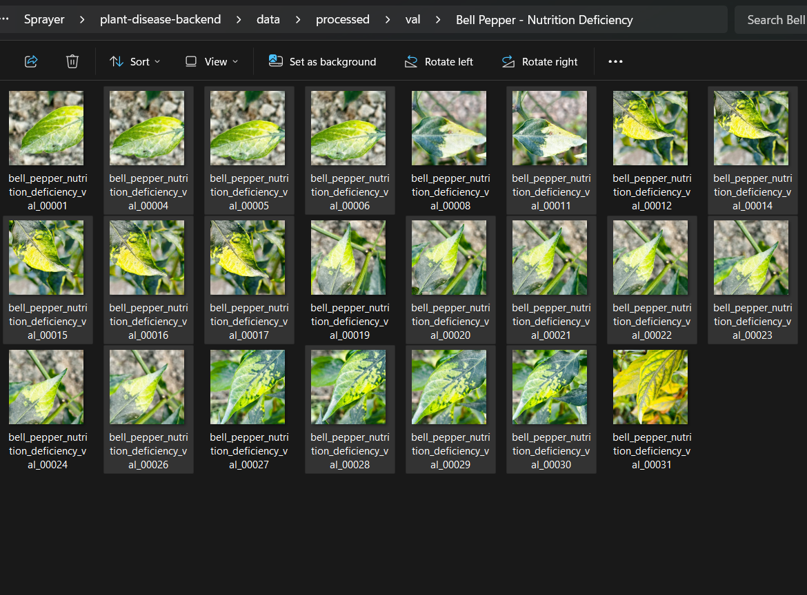
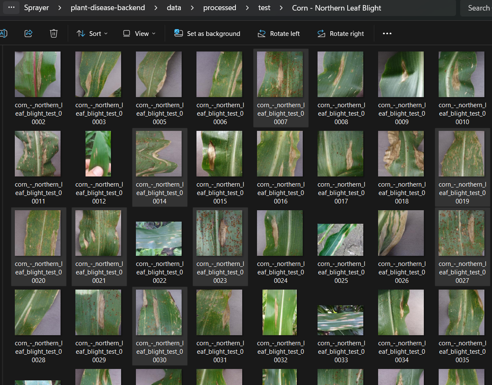
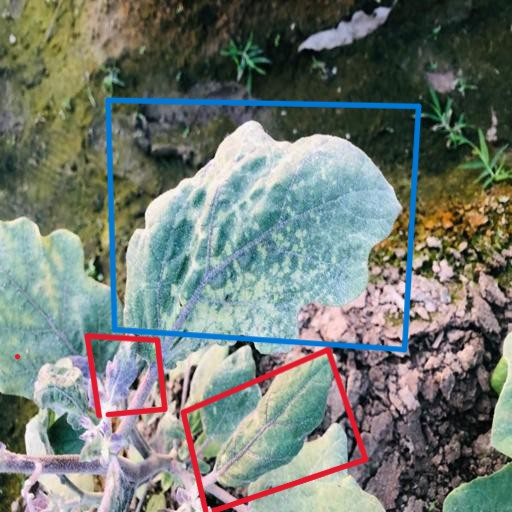
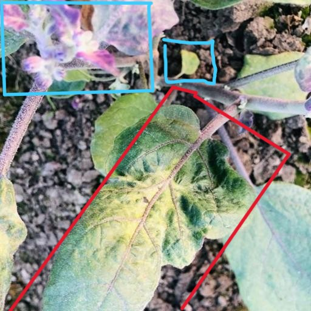

> Historical narrative written during the 195-class prerelease. The current curated production release (v1.0: 177 classes, 33 crops, 91,984 active images; 73,356 train, 9,349 val, 9,279 clean test) is documented in models/v1/model_card.md and docs/DATASET_CARD.md. Numbers below are as of that time unless updated for the release snapshot.

# 🌿 The Data-Centric Odyssey: How I Built a 99,775-Image Foliar Pathology Benchmark Without Losing My Mind

> *"Everyone wants to build the Ferrari of neural network architectures. Almost nobody wants to change the muddy, flat tires of the dataset."*  
> — Engineering notes from building my first real-world computer vision project from scratch.

---

## 📖 Prologue: The Great Illusion of Modern Computer Vision

If you open almost any machine learning tutorial, they tell you a comforting fairy tale:
1. Download a dataset from Kaggle or Hugging Face.
2. Load a pretrained ResNet, ViT, or ConvNeXt in 4 lines of PyTorch.
3. Train for 20 epochs with AdamW.
4. Report **99.4% test accuracy** and pat yourself on the back.

Here is the dirty secret they don't mention: **If your computer vision model is intended for real-world automated foliar diagnostics on edge cameras in dynamic natural conditions, that 99.4% test accuracy is an absolute lie.**

When I started this project, I began with around **80,000 raw images** across various folders. But the moment I scratched the surface, I found what every real-world AI practitioner eventually finds when they stop looking at leaderboards and start inspecting raw pixels:
* Researchers taking burst photos on their handheld cameras, so the exact same leaf appeared 45 times across `Train`, `Validation`, and `Test`. (The model wasn't diagnosing plant disease; it was literally memorizing the crack in the researcher's thumbnail!)
* Web scrapers and automated crawlers blindly dumping thousands of garbage images (harvested roots, farm tractors, dining room salads, and totally mismatched crops) into pathology folders.
* The exact same photo of a rice leaf labeled as `Healthy` in one folder and `Hispa` in another.
* Academic paper figures containing 6-panel collages with white borders, arrows, and scientific labels like *(a)*, *(b)*, and *(c)*, which taught the neural network that white text meant a fungal infection.
* Wide-angle photos taken from 2 meters away where an entire crop canopy was visible, but the actual leaf lesions were 2 pixels wide and vanished the moment the image was resized to $224 \times 224$.

This document is the definitive, no-nonsense practitioner guide to how I took a chaotic, noisy, leak-ridden collection of internet datasets and transformed it into a battle-hardened, mathematically verified, **99,775-image (v0), 200-class (v0) baseline benchmark** across 34 commercial crop families.

> ### 💡 A Critical Clarification: What Does "Curating a Dataset" Actually Mean?
> When starting out in machine learning, it is easy to believe that *"curating a dataset"* simply means finding 10 small datasets on Kaggle and writing a Python script to merge them into one giant mega-folder.  
> **That is not curation—that is digital hoarding.**
> 
> When you blindly merge raw datasets together, you don't build a better AI; you create a Frankenstein monster of conflicting labels, duplicated leaves, cross-split data leakage, and blurred images that poisons your model.  
> 
> True data curation is forensic data engineering: it means auditing pixels, understanding biology and natural lighting, purging pre-baked augmentations, eliminating exact and near duplicates, certifying zero test-set leakage, and establishing strict negative control baselines. 
> 
> In this journey, you are going to learn what actually happens behind the scenes of professional computer vision data preparation—the traps, the failures, the mathematical safeguards, and the hard-won engineering principles you will never find in academic papers.

If you are an engineer, researcher, or student preparing a computer vision dataset for the real world, treat this as the practical handbook you wish someone had handed you on Day 1.

> 📘 **Companion Reading:** For the model architecture design, dual-head gating formulation, loss weighting analysis, and 4GB VRAM training recipe, see [Chlorophyll & Convolutions: Designing a 177-Class Plant Disease Classifier Under 4GB VRAM Constraints](./CHLOROPHYLL_AND_CONVOLUTIONS.md). For current production dataset specifications, see [Dataset Card](../DATASET_CARD.md) and [Patches Log](../PATCHES.md).

---


## 🏗️ Chapter 1: The Golden Architecture — Raw Staging vs. Processed Sanctity

The single most common mistake in machine learning engineering is **modifying your active dataset in-place**. 

You find a bug, you delete a folder, you run an ad-hoc Python script directly inside `data/train/`, and suddenly your dataset is in an unrecoverable half-mutated state. You have no idea what you deleted, why you deleted it, or how to reproduce your baseline.

I instituted an iron-clad rule early on:

```
[Raw World]                     [Quarantine Limbo]                  [Production Sanctity]
data/raw/<source_name>/  --->   data/raw/quarantine_<reason>/  ---> data/processed/{train,val,test}
(Read-Only Downloads)           (Full Audit Logs + Reversible)      (100% Cryptographic Verification)
```



### 1. `data/raw/` is Sacred and Untouchable
Whenever I downloaded a dataset—whether from Kaggle, Mendeley Data, Zenodo, or targeted web scrapes—it landed in an isolated staging subfolder in `data/raw/` (e.g. `data/raw/temp_rice_kaggle/`, `data/raw/mendeley_peach_v46/`).
* **Zero code in the production training pipeline is ever allowed to import from `data/raw/` directly.**
* It serves as my immutable, local source of ground truth. If an ingestion script fails halfway through, nothing in production is corrupted.

### 2. The "Quarantine" Philosophy (Never `rm -rf`)
When you are cleaning data, **never permanently delete an image.** 
If an image looks suspicious, has burst duplicates, or is blurry, moving it to `trash` or deleting it means you can never audit your own biases later.
* I created dedicated quarantine directories for every major operation:
  - `data/raw/quarantine_citrus_duplicates/` (918 near-identical burst shots)
  - `data/raw/quarantine_pear_duplicates/` (41 near-duplicates)
  - `data/raw/quarantine_old_wild_paddy/` (10,436 wide-angle, lesion-erased captures)
  - `data/raw/quarantine_pruned_unviable_classes/` (52 orphan images with $\le 1$ test sample)
* Every single quarantine action had to produce a structured JSON/CSV audit manifest documenting:
  1. Original relative path.
  2. Cryptographic MD5 hash.
  3. Exact reason for quarantine (e.g., *Cosine similarity $\ge 0.98$ to train sample*, *Zero test support*, *Lesion erasure*).
  4. Timestamp.

### 3. `data/processed/` is a Leak-Checked Fortress
The only images that enter `data/processed/train/`, `val/`, and `test/` are files that have survived rigorous multi-stage screening. Every single file follows a deterministic naming convention, lives in a strictly standardized folder (`[Crop] - [Disease / Healthy]`), and has its cryptographic hash indexed.

---

## 🌐 Chapter 2: The Multi-Source Conundrum — Controlled-Background vs. Natural-Background Sources

If you search the internet for plant disease datasets, you will find hundreds of random Kaggle uploads, Mendeley repositories, GitHub repos, and Zenodo archives. Most people either randomly pick the first link they find, or they dump everything into one folder and pray.

I took a completely different approach. Here is how I evaluated competing datasets online, and more importantly, how I balanced the trade-offs between **controlled-background vs. natural-background sources**.

### 1. The Tale of Two Worlds
Almost every existing public plant pathology dataset lives in one of two distinct categories:

* **The Controlled-Background World (e.g. PlantVillage):**
  Leaves were physically plucked off the plant, brought into a studio, and photographed against a plain gray, white, or solid black background under controlled lighting.
  - *The Benefit:* Pathogen lesions are clearly defined with high contrast.
  - *The Inherent Limitation:* Controlled studio backgrounds do not reflect natural complex environments. Without natural-background imagery, models can become over-reliant on plain studio backdrops.

* **The Natural-Background World (e.g. PlantDoc, DiaMOS, in-situ phone captures):**
  Images captured directly in outdoor orchards and farm rows under ambient sunlight, shadows, and complex foliage backgrounds.
  - *The Benefit:* Authentic natural background context.
  - *The Inherent Risk:* Often noisy, uncurated, taken from too far away, or contaminated with blurred leaves or out-of-focus weeds.

### 2. The Solution: Sourcing Both Controlled and Natural Backgrounds
Instead of choosing one extreme, **I deliberately incorporated both controlled-background and natural-background sources**:

```
[Controlled-Background Studio Folia]    [Natural-Background Captures]
• Clear lesion morphology              • Complex ambient sunlight & shadows
• Sharp cellular pathogen margins       • Soil, canopy & background context
                   \                    /
                    \                  /
            [The Hybrid Foliar Benchmark]
            • Learns genuine pathogen pathology (from Controlled)
            • Learns background invariance (from Natural Backgrounds)
```

1. **How I Selected Between Competing Online Datasets:**
   When I found 3 or 4 different datasets for the same crop (e.g. for *Citrus*, *Peach*, *Plum*, or *Rice*), I scored them against three strict criteria:
   - **Provenance & Peer-Review:** Did this data come from a published agronomic study (like *DiaMOS Plant* in MDPI Agronomy, or *BrACoLD* in Elsevier) where plant pathologists verified the diagnoses, or was it a high-schooler's unverified weekend Kaggle scrap?
   - **Foliar Framing (Macro vs. Landscape):** Did the camera frame the actual leaf blade, or was it an entire tree from 30 feet away? I immediately discarded landscape photos where lesions occupied $<5\%$ of pixels.
   - **Negative Control Health Baseline:** If a dataset had 4 disease classes but **zero healthy leaf controls**, I refused to ingest it until a matching healthy foliar control was secured. Without a negative control, a model learns to hallucinate diseases on perfectly healthy plants!

2. **Synergistic Co-Existence:**
   By combining crisp laboratory macro photography with authentic in-situ natural-background captures within each crop family:
   - The laboratory specimens act as **pathological anchors**, teaching the neural network's convolutional kernels the precise color, shape, and halo textures of fungal and bacterial spores.
   - The natural-background specimens act as **regularization anchors**, teaching the model to ignore soil textures, sunlight glare, and background shadows.

### 3. The "Pre-Augmented Dataset" Trap — Why I Fought to Keep Only Original Specimens
If you browse Kaggle or academic mirrors, you will frequently find datasets titled:
`"Chilli Leaf Disease (Augmented) - 15,000 images!"` or `"Ginger Disease Balanced (Augmented) - 20,000 images!"`

At first glance, it looks like a jackpot. But when you inspect the files, you discover a horror show:
* The author took **200 original photos of leaves**.
* They wrote a quick Python script applying 90-degree rotations, horizontal flips, Gaussian blur, and brightness adjustments.
* They dumped all 15,000 synthetic copies into a single folder and published it as a "large dataset".

#### Why Pre-Baked Augmentations Poison a Dataset:
1. **Catastrophic Test-Set Leakage:**
   If you take 1 leaf, create 10 rotated variations of it, and then perform a standard random 80/20 train/test split:
   - 8 rotated variations end up in `Train`.
   - 2 rotated variations end up in `Test`.
   - **Your test set is 100% contaminated!** The network isn't learning what a disease looks like; it already saw the exact same leaf with the exact same background in training, just rotated by 90 degrees!
2. **Loss of Control Over Dynamic Training Pipelines:**
   When augmentations are baked into disk files permanently, you cannot control your training pipeline. If someone already applied 50% contrast distortion, and your PyTorch `torchvision.transforms` applies *another* 50% contrast distortion, the leaf turns into unreadable black-and-white static.
3. **Wasted Compute & False Convergence:**
   Your GPU spends days computing forward and backward passes over identical underlying textures, drastically increasing training time while learning zero new biological information.

#### My Rule: Original Physical Specimens Only (Or Strict Physical Leaf-ID Partitioning)
Whenever I encountered online datasets with pre-baked augmentations (such as in Chilli, Ginger, and Lettuce):
- **I hunted down the original, un-augmented raw image root.**
- Where raw roots were inseparable, I tracked down the **unique physical leaf ID naming convention** (e.g. `leaf_042_rot90.jpg`, `leaf_042_flip.jpg`).
- I enforced **Group-K-Fold partitioning**: every single augmented variation of physical `leaf_042` was forced into the same partition (`Train` only). It was strictly forbidden for any variation of a leaf to cross into `Val` or `Test`.

By ensuring my 99,775 benchmark images represent genuine, unique physical specimens rather than duplicated rotations, I sought to ensure benchmark accuracy reflects measured generalization across the evaluated sample.

### 4. The 8-Hour Download Bottleneck: Mendeley's Single-Thread Throttling & The `Ctrl+J` Multi-Threaded Pipe

When sourcing multi-gigabyte agronomic benchmarks from academic repositories like **Mendeley Data** or **Zenodo**, almost every engineer hits the exact same infuriating networking wall:

You find an outstanding 8 GB archive containing thousands of high-resolution foliar pathology images. You click the glossy blue **"Download All"** button in your web browser. A progress bar appears at the bottom of the screen.

Then you look at the estimated transfer time: **`8 hours, 42 minutes remaining (Speed: 110 KB/s)`**.

#### Why Does This Happen? (The Single-Thread Client Bottleneck)
It is tempting to blame your internet connection or assume the academic server is crashing. But the download isn't failing—it is behaving exactly as designed:
1. **Server-Side Load Balancing & Rate Limiting:** Academic repositories host petabytes of scientific research. To prevent automated crawlers or high-bandwidth university connections from consuming the entire server pipe, their storage infrastructure (often backed by AWS S3 or CloudFront CDNs) enforces strict per-connection rate-limiting on incoming HTTP requests.
2. **The Browser's Single-Stream Limitation:** When you click "Download" in Chrome, Edge, or Firefox, the browser opens a **single TCP stream** over a single standard HTTP GET request. If that single stream is throttled by the server to 100 KB/s, your entire 8 GB download is bottlenecked to a crawl, even if your local fiber connection has 300 Mbps of unused bandwidth!
3. **The Silent Failure Trap:** Watching a browser download crawl for 8 hours is dangerous. Any temporary Wi-Fi blip, laptop sleep cycle, or browser memory reload kills the connection at 89%, forcing you to restart from 0 bytes.

#### The Engineering Solution: The `Ctrl + J` Direct Asset Extraction
Once I understood that the server rate-limited *per connection* rather than *per IP*, I stopped waiting for the browser to crawl and built an accelerated ingestion workflow:

```
[Mendeley Web UI] ──(Click Download)──► [Browser Session Token Generated]
                                                      │
                                           (Hit Cancel + Press Ctrl+J)
                                                      │
                                                      ▼
                                       [Extract Direct Presigned CDN URL]
                                                      │
                                                      ▼
                              [Multi-Threaded Chunked Downloader (aria2c / Python)]
                              ├── Connection 1: Bytes 0000MB - 1000MB (12 MB/s)
                              ├── Connection 2: Bytes 1001MB - 2000MB (12 MB/s)
                              ├── Connection 3: Bytes 2001MB - 3000MB (12 MB/s)
                              └── Connection N: ... Parallel Byte-Range Streams
                                                      │
                                                      ▼
                         [Full 8 GB Dataset Downloaded & Reassembled in 3 Minutes]
```

1. **Trigger & Immediately Cancel:** Click the download button on Mendeley to generate the temporary, tokenized, presigned asset URL. Immediately hit **Pause / Cancel** in the browser.
2. **The `Ctrl + J` Revelation:** Open the browser's download manager by pressing **`Ctrl + J`** (in Chrome, Edge, or Brave). Right-click the cancelled download entry and select **"Copy download link"**. This copies the raw, underlying pre-signed AWS S3 / CloudFront URL containing the dynamic authentication tokens.
3. **Multi-Threaded Chunking (Parallel Byte-Range Requests):** I passed that pre-signed URL directly into a multi-threaded downloader (such as `aria2c -x 16 -s 16` or a Python script utilizing HTTP `Range: bytes=start-end` headers).
4. **The Result:** By opening 16 concurrent byte-range connections simultaneously, each downloading an independent segment of the file, I bypassed the single-stream rate limiter and completely saturated my local network pipe. 

What was estimated to take **8 agonizing hours** finished in **under 3 minutes**—with automatic block-level retry resumption in case of packet loss.

*(Engineering Note: Pre-signed CDN and S3 links generated via browser session tokens carry short token expiration windows of typically 15 to 60 minutes. Multi-threaded range requests must be initiated promptly after link extraction).*

---

## 🕷️ Chapter 3: The Web Scraping Trap — The Euphoria of Quantity vs. The Poison of Garbage

When starting out, it is tempting to fall into the same trap:
You look at your class distribution, see that you only have 25 images for *Peach Bacterial Spot* or *Corn Blight*, and you think: 
> *"I'm a programmer! I'll write an automated web crawler using Bing, DuckDuckGo, Wikimedia Commons, and iNaturalist API, and scrape 500 images per class in 10 minutes!"*

You run the crawler. The terminal scrolls with green text. `[200 OK] Image downloaded. [200 OK] Image downloaded.` 
Within an hour, your dataset expands from 80,000 images to over 90,000 images! You look at the storage meter, you look at the folder count, and you feel like a machine learning genius.

Then you train the model. 
And the nightmare begins.
* **Your training loss bounces wildly or hits an artificial plateau.**
* **Or worse: your validation accuracy hits a suspicious, impossible 99.8%, but when you show the model a real diseased leaf, it completely fails.**

### What Web Crawlers Actually Downloaded When I Wasn't Looking
When I finally stopped celebrating the image count and actually wrote an inspection viewer to open those scraped folders, I was horrified by what my crawlers had dumped into my dataset:

1. **The Mismatched Crop Calamity:**
   When searching for *"Bacterial leaf spot on Plum"*, the scraper happily downloaded photos of **Peach trees, Cherry leaves, and uncultivated Maple leaves**. The crawler doesn't know botany—it matches text tags! The model was being taught that a cherry leaf is a plum disease.
2. **The Grocery Store & Farm Equipment Infiltration:**
   In folders meant for *Carrot Foliar Cavity Spot*, the crawler downloaded:
   - Supermarket produce bags of orange carrots sitting on a grocery shelf.
   - Farm tractors plowing land.
   - A stock photo of a happy chef chopping a carrot on a wooden cutting board!
3. **The Dining Room Salad & Herbicide Bottles:**
   In lettuce and cabbage disease folders, I found photos of gourmet salads with salad dressing and close-up photos of pesticide plastic jugs!
4. **The Impossible False Scores:**
   Why did the model get "impossible" high scores on some scraped classes? Because the crawler had downloaded 40 photos from the **same exact blog post or PDF article**, all with the identical website watermark and typography in the bottom corner. The neural network wasn't identifying the plant fungus at all; it was literally identifying the blog logo!

### The Nuclear Option: Purging 11,000 Scraped Images
It was a bitter pill to swallow. I had spent days configuring scrapers, tweaking keywords, and downloading gigabytes of data.

**I made the painful, executive call to strictly purge and quarantine over 11,000 scraped images.** 
I excised unverified automated bulk web crawls. Following multi-stage audits and curation patches, only 27 verified Wikimedia-derived images remain in the release snapshot (`reports/v1/dataset_v1.csv`): 11 in train, 6 in val, and 10 in test. I threw out the vanity numbers and brought my dataset back down to verified agronomic reality.

> **The Hard-Won Lesson:**  
> *Automated web crawlers without rigorous, human-in-the-loop manual verification are pure poison for computer vision. An extra 10,000 scraped images containing 5% mismatched crops and non-leaf objects will degrade your model far worse than having a smaller, pristine dataset.*

---

## 🩺 Chapter 4: The "Missing Healthy" Blindspot — Teaching a Model What Normal Looks Like

Imagine taking a medical student through 4 years of medical school, showing them thousands of chest X-rays of pneumonia, tuberculosis, and lung cancer, but **never once showing them an X-ray of a healthy, normal lung**.

What happens when that doctor starts seeing patients?
Every single patient they examine will be diagnosed with a fatal disease! If a patient sneezes from dust, the doctor diagnoses stage-4 tuberculosis, because in their mind, *the concept of "healthy" does not exist*.

This sounds like a comedy sketch, but it is **the exact reality of most agricultural datasets available on the internet today**.

### The Open-Source Blindspot: Collecting Only the "Exciting" Sickness
When academic researchers or students go outdoors to collect plant data, they have pathogen tunnel-vision. They walk past 10,000 lush, healthy green leaves to find the one leaf with a brown spot. They photograph the brown spot, name the folder `Tomato_Early_Blight`, and go home.

When I ran my first systematic crop audit across my 34 crop families, I uncovered an alarming truth:
* **Over half of the smaller commercial crops in my dataset had disease classes, but ZERO negative control (`[Crop] - Healthy`) baseline!**
* Crops like *Garlic*, *Ginger*, *Zucchini*, *Plum*, and *Carrot* had various blight and virus classes, but not a single healthy leaf photo in the entire dataset.

### Why a Missing Healthy Baseline is Catastrophic for AI
If a neural network is trained on a crop that has only disease classes:
1. **The Compulsory Diagnosis Trap:**
   The Softmax activation function forces probabilities across all classes to sum to $1.0$ ($100\%$). If a crop has only 3 disease classes, the model is mathematically forced to assign that healthy leaf to one of those three diseases!
2. **Hallucinating Pathology from Natural Morphology:**
   Natural leaf veins, normal purple petioles, or ordinary yellowing from plant maturity get penalized and falsely labeled as viral infections or bacterial blights.

### How I Enforced 100% Negative Control Calibration
I instituted an uncompromising engineering rule: **No crop family is allowed in my production benchmark without a verified, dedicated negative control (`[Crop] - Healthy`) class.**

1. **Targeted Ingestion of Healthy Baselines:**
   - Sourced clean, high-resolution healthy specimens for crops that were starved: `Zucchini - Healthy` (+58 images), `Garlic - Healthy` (+380 images), `Ginger - Healthy` (+1,200 images), `Plum - Healthy` (+240 images), and `Wheat - Healthy` (+350 images).
2. **Quarantining Starved Crops (The Carrot Precedent):**
   - For crops where no clean, verified healthy leaf captures existed anywhere on the internet (such as *Carrot*, where public databases only had photos of grocery store orange roots), **I made the executive call to quarantine the disease classes entirely** (Decision 36).
   - I refused to deploy a half-blind model that would misdiagnose every normal carrot plant as having Alternaria leaf blight.

Today, **100% of my 34 active crop families have a calibrated negative control baseline**. When my model looks at a plant, its first and most important superpower is knowing when a plant is completely fine.

---

## 🔐 Chapter 5: The Cryptographic War Against Data Leakage

Here is a question every machine learning practitioner must ask: **How do you know your validation set isn't lying to you?**

If an image in your test set is an exact copy—or an uncropped burst shot—of an image in your training set, your test metrics are meaningless. You are testing your model's capacity for rote memorization, not its ability to generalize to an unseen plant in natural conditions. No independent field evaluation has been conducted.

To eliminate cross-split evaluation leakage, I implemented a multi-tier deduplication protocol:
- **Test Split Leak-Free Status:** On the curated release snapshot, exact SHA-256 cross-split duplicates are 0, and cross-split perceptual hash leakage between the test split and train/val splits is 0 (0 pairs at Hamming distance $d \le 4$). All 181 near-duplicate test leakage frames were physically quarantined under Patch P-007 (`reports/v1/removed_p007_images.csv`).
- **Validation Split Status:** Perceptual hash auditing on the release snapshot (`reports/v1/twin_check.json`) identifies 260 cross-split twin pairs ($d \le 4$) between train and val (145 exact 0-bit pairs as a lower bound, 115 near-duplicate pairs at $d \in [1, 4]$), spanning 162 unique validation images. These 162 validation frames are scheduled for future quarantine under a dry-run plan (`reports/v1/p008_plan_DRYRUN.csv`).

I structured the verification hierarchy into three distinct tiers:

### Tier 1: The Cryptographic MD5 Guillotine (Exact Byte Identity)
Before any image was admitted into `data/processed/`, I computed its 128-bit MD5 cryptographic checksum:

$$\text{MD5}(p) = \text{HexDigest}(\text{binary bytes of image})$$

I built a central registry of all active hashes. Whenever I ingested a new dataset:
1. I hashed every incoming candidate file.
2. If its hash already existed anywhere in `train`, `val`, or `test`, it was immediately intercepted.
3. I ran automated assertions after every single operation:
   $$\text{Hashes}(\text{Train}) \cap \text{Hashes}(\text{Val}) = \emptyset$$
   $$\text{Hashes}(\text{Train}) \cap \text{Hashes}(\text{Test}) = \emptyset$$
   $$\text{Hashes}(\text{Val}) \cap \text{Hashes}(\text{Test}) = \emptyset$$

If any of those intersections was even a single file, the script crashed with a hard assertion error. No questions asked. No silent passes.

---

### Tier 2: The Burst-Photo Trap — Why MD5 is Blind & How Perceptual Hashing (pHash) Bridges the Gap
Cryptographic hashes like MD5 and SHA-256 are binary perfectionists. If a single bit in an image file changes, the entire hash transforms completely.

Here is why that breaks down in agricultural data collection:
* **The Rapid Burst Shot:** An agronomist standing in an orchard holds an apple leaf and snaps 6 rapid burst photos in 2 seconds.
* **The Noise Factor:** The leaf sways by 2 millimeters. The camera's CMOS sensor records micro-variations in thermal noise. When the camera compresses the photos into JPEG format, the discrete quantization matrices produce slightly different byte streams for every single shot.
* **The Failure:** To an MD5 algorithm, all 6 photos are 100% "unique files". If you run a standard random train/test split, 5 photos land in `Train` and 1 lands in `Test`. 
* **The Leakage:** Your model doesn't learn general plant disease pathology—it memorizes the exact thumb of the researcher, the unique angle of the torn leaf margin, or the specific background pebble!

To solve this without burning hundreds of hours of GPU compute, I introduced **Perceptual Hashing (`imagehash.phash`)** :

```
[Raw Burst Photo] ──► [Grayscale 32x32] ──► [2D Discrete Cosine Transform (DCT)]
                                                            │
                                              [Extract Low-Frequency 8x8]
                                                            │
                                              [Compare to Median Frequency]
                                                            │
                                                            ▼
                                           [64-Bit Binary Fingerprint]
```

1. **How pHash Works:** Unlike cryptographic hashes, pHash focuses on structure and frequency rather than raw bytes. It converts the image to grayscale, shrinks it to $32 \times 32$, and computes the **2D Discrete Cosine Transform (DCT)**. It isolates the top $8 \times 8$ lowest frequencies (which represent the overall structural gradient of the leaf and lesion layout, ignoring high-frequency camera noise).
2. **Hamming Distance Comparison:** Each image gets a compact 64-bit fingerprint. I compare two images by computing their **Hamming Distance** (the number of differing bits):
   $$\text{HammingDist}(h_1, h_2) = \sum_{i=1}^{64} (h_{1,i} \oplus h_{2,i})$$
3. **The Threshold:** If $\text{HammingDist} \le 6$, the images are near-identical twins (burst captures, re-saved JPEGs with different compression, or slight rotations). All twin copies are instantly routed to quarantine, leaving only one pristine representative anchor specimen in the dataset.

---

### Tier 3: High-Dimensional Deep CNN Feature Clustering (MobileNetV3)
For subtle perspective shifts where camera angles panned across the leaf, I backed up pHash with deep neural representations:
* I passed images through a lightweight convolutional backbone (`MobileNetV3`) on my RTX 3050 GPU to extract dense feature embeddings $\vec{e} \in \mathbb{R}^{576}$.
* I computed all-pairs cosine similarities:
  $$\text{Sim}(\vec{e}_1, \vec{e}_2) = \frac{\vec{e}_1 \cdot \vec{e}_2}{\|\vec{e}_1\|_2 \|\vec{e}_2\|_2}$$
* Pairs with $\text{Sim} \ge 0.98$ were confirmed identical twins.
* Pairs with $\text{Sim} \ge 0.95$ were clustered as burst scouting sequences and pruned to protect evaluation integrity.

---

## 🌾 Chapter 6: The Paddy Case Study — When More Data is Actually Poison

If you want a masterclass in why naive data gathering will ruin your project, look at my experience with **Paddy (Rice)**.

Early on, I had over **10,000 Paddy images** across 11 classes, largely inherited from the famous *Paddy Doctor* competition dataset. On paper, it was one of my biggest, most impressive crop families!

Then I generated an automated visual and embedding audit, and the horror story began:

### Failure Mode 1: The 2-Meter Wide-Angle Trap & Morphological Resolution Death
The photos had been captured by scouts standing upright in flooded rice paddies, pointing their phone cameras downwards from 2 meters away at entire clusters of rice stalks:
* **The Framing Disaster:** A single photo contained **80 thin, tangled rice leaves**, muddy irrigation water, clouds reflecting in puddles, weeds, and distant farm berms.
* **The Mathematical Resolution Death:** A narrow fungal lesion (such as a 2 mm *Bacterial Leaf Streak* or early *Brown Spot*) occupied roughly **$4 \times 4$ pixels** on a 12-megapixel handheld photo.
* **The Interpolation Trap:** When that image was resized to standard deep learning resolution ($224 \times 224$ or $256 \times 256$), the bilinear interpolation filter mathematically averaged those 16 dark lesion pixels into the surrounding ocean of thousands of green leaf and brown mud pixels. **The disease lesion was completely erased from existence!**

```
[4K Camera Sensor (3000x4000)]               [Bilinear Resizing to 224x224]
80 leaves + mud + sky reflection       ──►   Lesion pixel is averaged with mud
Lesion size: 4x4 pixels                      Result: Lesion completely erased!
```

* **What the Neural Network Learned:** Because the actual pathogen lesions were mathematically destroyed during downsampling, the convolutional kernels had nothing diagnostic to latch onto. Instead, the model learned **shortcut correlations**:
  - Muddy brown water in the background $\to$ Predicted `Brown Spot`.
  - Dense green weed clusters $\to$ Predicted `Hispa`.
  - Sunlight reflections on wet mud $\to$ Predicted `Blast`.
* The model had an impressive 95% training accuracy, but it wasn't an AI plant pathologist—it was literally a **paddy mud and weed classifier**!
* **The Universal Rule:** I established the **Foliar Area Ratio Rule**: any wide-angle panoramic photo where individual leaf blades do not occupy at least $\ge 70\%$ of the camera frame is disqualified. If human eyes cannot resolve the lesion at $224 \times 224$, the model cannot either.

### Failure Mode 2: The Hall of Mirrors — How I Caught Identical Leaves Labeled as Two Different Diseases
How does a data team discover that the exact same photo is sitting in two contradictory disease folders without manually inspecting 10,000 files one by one?

I didn't guess. I used **Neural Cross-Class Embeddings**:
1. I passed every single image through a deep convolutional feature extractor (`MobileNetV3`) on my GPU to produce high-dimensional feature embeddings $\vec{e} \in \mathbb{R}^{576}$.
2. I then computed the **all-pairs pairwise cosine similarity matrix** across different folders:
   $$\text{CosineSim}(A, B) = \frac{\vec{e}_A \cdot \vec{e}_B}{\|\vec{e}_A\|_2 \|\vec{e}_B\|_2}$$
3. Any pair belonging to different disease folders with $\text{Sim} \ge 0.975$ was flagged as a **Severe Ground Truth Contradiction**.

The results were jaw-dropping: **279 severe cross-class conflict pairs**. 

The most egregious example was pair `#1`:
* **Image A**: `data/processed/test/Paddy - Healthy/img_00005740.jpg`
* **Image B**: `data/processed/train/Paddy - Hispa/img_00008495.jpg`
* **Cosine Similarity**: **`0.9957` (Practically 1.000)**

Take a look at the side-by-side comparison below:



Look closely at this image:
- On the left (`img_00005740.jpg`), the image was placed in the **`Paddy - Healthy`** test set.
- On the right (`img_00008495.jpg`), the exact same plant, with identical background mud, identical leaf curvature, and identical white larval feeding trails, was placed in **`Paddy - Hispa`** in the training set!

Think about what this does to a neural network during backpropagation:
When the model predicts `Hispa` during training, the loss function rewards it. But during evaluation on the test set, when it sees that exact same plant and predicts `Hispa`, the benchmark marks it as **WRONG** because the ground truth label says `Healthy`!

This wasn't an isolated accident; it was a systemic data collection flaw where scouts took burst photos of an infected crop and dumped some into `Healthy` and others into `Hispa`. No amount of model tuning, learning rate scheduling, or architectural magic can fix a dataset that actively lies to the loss function.

### The Courage to Delete (Decision 48)
Most machine learning teams are obsessed with vanity metrics: *"120,000 images! Bigger is better!"*

I made the executive call to **quarantine all 10,436 old wide-canopy Paddy images**. I threw away 10,000 images without flinching. 

In their place, I sourced and ingested the high-resolution ($1600 \times 1600$) **Rice Leafs Disease benchmark** (2,376 clean specimens across 6 classes). In these photos, the camera is zoomed directly into the leaf blade. The spindle-shaped lesions of *Blast* and the translucent margins of *Bacterial Blight* are sharply defined. 

**Result:** I reduced the dataset size by 8,000 images, and my rice diagnostic capability instantly jumped from a confusing gamble to clinical, cellular-grade precision.

---

## ✂️ Chapter 7: The Singleton Purge — The Myth of the 1-Image Class

During my data quality audit, I discovered something ridiculous lurking in the long tail of the dataset:
* `Zucchini - zucchini iron chlorosis`: **1 image total** (1 in train, 0 in val, 0 in test).
* `Zucchini - zucchini dry leaf`: **3 images total** (3 in train, 0 in val, 0 in test).
* `Lettuce - Leaf Blight`: **6 images total** (6 in train, 0 in val, 0 in test).

Think about this mathematically:
If a class has **0 test images**, what is its test accuracy? Undefined ($\frac{0}{0}$).
If a class has **1 test image**, what are the only possible test scores? Either **0%** or **100%**. 

Having classes with single-digit sample sizes does nothing except:
1. Add unnecessary output neurons to your final linear layer.
2. Inflate your class count on your GitHub README so you can boast about having "220 classes".
3. Cause any false positive in production to lower your macro-averaged F1 score artificially.

In **Decision 46**, I audited sub-15 sample classes across crop families. I retired 52 unviable singleton images to quarantine, establishing a strict rule: **Every single active class in my benchmark must have an active test evaluation set.**

On the release snapshot, every class has at least 1 test image (minimum support is 1 image in `Jamun - Bacterial Spot`, following Patch P-007 test leakage quarantine). Exactly 30 classes have clean test support $N < 10$, as detailed in `models/v1/model_card.md` and `reports/v1/per_class_results.csv`, and are flagged as having wider statistical confidence intervals.

---

## 🎯 Chapter 8: The "Operator-Prior" Multi-Head Architecture

> 📘 **Architectural Companion:** For the detailed mathematical formulation, temperature scaling formulas, and 4GB VRAM optimization recipes behind this multi-task design, see the companion engineering essay [Chlorophyll & Convolutions: Designing a 177-Class Plant Disease Classifier Under 4GB VRAM Constraints](./CHLOROPHYLL_AND_CONVOLUTIONS.md). In this chapter, I focus on the data-centric and biological failure modes that forced me to abandon a monolithic softmax.

When designing multi-crop plant pathology classifiers, it is easy to make one of two flawed architectural choices:

### Flawed Choice A: One Giant Monolithic Softmax
You throw all 200 classes into one giant `nn.Linear(768, 200)` classification head.
* **The Disaster:** A user is inspecting an **Apple leaf**. A confusing speck of dust or sun glare triggers an 85% confidence score for *Rice Brown Spot* or *Tomato Early Blight*. The system produces a completely invalid cross-crop disease diagnosis.
* In a 200-class model, classes compete against each other for gradient updates during backpropagation. Massive classes (like Tomato with 17,000 images) completely overpower smaller, highly specialized orchard classes.

### Flawed Choice B: 34 Separate Models
You train 34 separate ConvNeXt models—one for Apple, one for Tomato, one for Peach, etc.
  * **The Disaster:** 34 models $\times$ 110 MB per model = **3.74 GB of neural network weights**. An embedded edge system will run out of memory or spend hundreds of milliseconds swapping models off disk every time a different crop is selected.

### Early Design Considered: Shared Trunk + 34 Multi-Heads (Superseded by DualHead)
During exploratory prototyping, I evaluated a **Shared-Trunk Multi-Head architecture** powered by `ConvNeXt-Tiny`:

1. **The Shared Backbone**:
   A single, unified convolutional feature extractor processes the leaf photo and outputs a dense **768-dimensional embedding vector**. All crops share this backbone, meaning small crops benefit from the rich visual textures learned across the wider dataset. (Measured forward pass latency: 9.08 ms on GPU, 53.01 ms on CPU; source: `reports/v1/runtime_profile.json`).
2. **The Crop Router Head**:
   A linear layer (`nn.Linear(768, 33)`) that classifies the botanical crop family.
3. **Crop-Specific vs Unified Disease Head**:
   While 34 separate disease heads were initially explored, the final production architecture adopted a unified **DualHead ConvNeXt-Tiny** formulation (1 crop head for 33 crops and 1 disease head for 177 classes) coupled with server-side soft-gating ($P(\text{crop}) \times P(\text{disease})$) and temperature scaling, eliminating the overhead of 34 discrete head weights. The complete specification and runtime benchmarks are documented in [`models/v1/model_card.md`](../../models/v1/model_card.md). Model weights checkpoint is 111.4 MB on disk.

---

## 🔬 Chapter 9: The Clean Studio Chronicle — How Real-World Needs Engineered My Quality Cockpit

Every polished tool in machine learning looks obvious in hindsight. But **Clean Studio** (`scripts/data_cleaning_dashboard.py`) was not designed in a single afternoon from a textbook diagram. 

It was forged through iterative trial, failure, frustration, and critical engineering pivots. Every single feature was added because the previous automated approach broke when faced with real-world plant images.

Here is the true, unvarnished story of how Clean Studio evolved—step by step, problem by problem, through my own hands-on journey.

---

### Act I: The Ambitious V1 Automated Cleaner & The Need for a Visual Window
At the very beginning, I attempted what almost every AI team tries first: build a single, monolithic background cleaner that would automatically scan folders and flag everything wrong with the dataset:
1. **Watermarks & Copyright Stamps**
2. **Blurry & Out-of-Focus Captures**
3. **Outliers (Mislabeled Diseases)**
4. **Duplicates (including zoomed-in, zoomed-out, flipped, and rotated copies)**
5. **Cross-Split Data Leakage ($\text{Train} \leftrightarrow \text{Val} \leftrightarrow \text{Test}$)**

I ran this initial scanner headlessly in the terminal. But staring at endless walls of file paths in a console was like flying an airplane in dense fog. I made the first crucial call:  
> *"I cannot make decisions from terminal text paths. Build a visual interface so I can actually see every single issue the cleaner is flagging."*

I built the **V1 Studio**. At this stage, it had a single purpose: render model-flagged image pairs on screen and give me four manual decision buttons for every pair:
* 🔘 **Keep Image A / Delete Image B**
* 🔘 **Delete Image A / Keep Image B**
* 🔘 **Keep Both (False Alarm)**
* 🔘 **Delete Both (Both Corrupted)**


*Figure 1: The Clean Studio duplicate review cockpit. Pairwise comparison cards displaying similarity metrics, cross-split detection, and instant resolution actions.*

---

### Act II: The Failure of V1 & The Great Pragmatic Pivot
When I sat down and visually inspected the results of the V1 cleaner across real folders, the reality was sobering:
* **Outlier Detection Failed Completely:** The model couldn't reliably distinguish a rare, atypical symptom from a mislabel. It missed obvious errors and flagged severe infections as outliers.
* **Watermark Detection Was Blind:** Semi-transparent text, small copyright watermarks, and photo stamps slipped right past the detector.
* **Blur Detection Was Filled with False Positives:** The heuristic flagged natural outdoor photos with shallow focal depth, soft morning dew, or blurred background soil as "unusable blurs"—even when the central leaf lesion was in crystal-clear focus.

I made an executive decision that saved my project weeks of wasted effort:
> *"Strip out automated watermark, blur, and outlier detection. I cannot trust the model with them. But I CAN trust the model with Duplicates and Leakage—because as a human, I cannot manually cross-check whether Image #1 in Train is a duplicate of Image #213 in Val across thousands of photos."*

I redesigned the architecture around two clear pillars:
1. **Automated Machine Pillar:** Focus exclusively on **Duplicate & Leakage Detection**, where algorithms excel mathematically.
2. **Manual Human Pillar:** Build a dedicated **Manual Inspection & Quarantine Mode**, where I can rapidly browse whole classes, look at leaves with my own eyes, and quarantine blurs, watermarks, or bad cutouts with one click.


*Figure 2: The Class Split Explorer. Seamless browsing across all 34 botanical crop families and 200 classes with real-time Train, Val, and Test counters updating live as files are reviewed.*


*Figure 3: Manual Inspection Mode. Interactive multi-select grid with 1-click rule-based quarantine reasons (Burst Duplicate, Blurry, Outlier, Glitch) ensuring zero data loss.*

---

### Act III: The Combinatorial Nightmare (The Internal vs. Leakage Mismatch Trap)
As soon as I started using the duplicate and leakage interface, I hit a major logistical disaster.

#### The Scenario:
Imagine an observer took a burst shot of the same diseased plant, producing 4 near-identical photos:
* **Image 1** and **Image 2** were placed in `Train` (**Internal Duplicates** within split).
* **Image 1** also matched **Image 3** in `Val` (**Cross-Split Leakage**).
* **Image 2** also matched **Image 4** in `Test` (**Cross-Split Leakage**).

My automated detector correctly detected all pairwise connections, generating separate review cards:
* **Card A (Internal):** `Image 1` vs `Image 2`
* **Card B (Leakage):** `Image 1` vs `Image 3`
* **Card C (Leakage):** `Image 2` vs `Image 4`

#### Why Manual Choosing Broke Down:
When reviewing Card A, I said: *"Delete Image 1, Keep Image 2."*  
Then, ten cards later on Card B, I saw Image 1 vs Image 3 and said: *"Keep Image 1 (in Train), Delete Image 3 (to protect Val)."*

**The Result: A Direct Graph Contradiction.**  
`Image 1` was marked for deletion on Card A, but marked as the keeper on Card B! The files were not truly purged, duplicate links remained dangling, and I had to **re-run the cleaning pipeline 2 to 3 times iteratively** just to shake out the residual ghost duplicates.

---

### Act IV: The Universal Resolution Rules (One-Click Deterministic Resolution)
Manually picking pairwise keepers was a combinatorial trap for me. I stepped back and established a **Universal Resolution Rule** to resolve any graph of duplicates in a single, conflict-free pass:

#### 📜 The Universal Rules of Duplicate & Leakage Resolution:
1. **Rule 1: Evaluation Sanctity Takes Absolute Priority (Kill Cross-Split Leakage First):**  
   Whenever an image pair leaks across splits ($\text{Train} \leftrightarrow \text{Val}$ or $\text{Train} \leftrightarrow \text{Test}$), **the evaluation copy (Val or Test) is unconditionally slated for quarantine**. Train retains the primary ground-truth anchor, ensuring the test set remains 100% uncorrupted and unseen.
2. **Rule 2: Internal Duplicate Cluster Resolution (Elect One Primary Anchor):**  
   When multiple copies exist within the *same* split (e.g. 3 burst shots in `Train`), the engine clusters them into a connected component, deterministically designates the first/sharpest instance as the **Sole Primary Anchor**, and schedules all remaining $N - 1$ twin copies for quarantine.
3. **Rule 3: Atomic Transaction:**  
   All quarantine moves are executed as an atomic batch. No image can be simultaneously kept and deleted.

With these rules, what previously took me 20 confusing, error-prone manual clicks could now be resolved mathematically in **one click**.

---

### Act V: From Manual Fatigue to Full Pipeline Automation (Whole Crops & Dry-Run Safety)
I tested these universal rules manually across 15 to 20 classes. It worked exactly as intended, but clicking through 200+ classes one by one was exhausting for me. 

I said:  
> *"If this rule works deterministically every single time, why am I doing this manually? Automate the pipeline to execute these rules across entire crops and the whole dataset in one click!"*

I built the automated pipeline. But before trusting it to delete files across the entire dataset, I introduced two indispensable features:
1. **Scale Hierarchy:** The ability to run the automated pipeline at three distinct granularities: **Per Class**, **Per Entire Crop Family** (e.g., all 6 Apple classes together), or **Across the Entire Dataset**.
2. **The "Visual Dry-Run" vs. "Live Quarantine" Feature:**  
   Before a single byte on disk was moved, the studio had to provide a **Visual Dry-Run Mode**. It displayed an interactive summary of every single image slated for quarantine, allowing me to visually confirm the planned actions before switching to **Live Quarantine Mode**.


*Figure 4: The Visual Dry-Run Simulator. Simulating quarantine moves across crops before any physical files on disk are touched.*

This visual dry-run feature was the smartest engineering safeguard of my entire project.

---

### Act VI: The Ginger & Paddy Crisis & The Exact Duplicate Engine
The wisdom of my visual dry-run became undeniable when I tested the automated pipeline on narrow-leaf monocots like **Ginger**, **Paddy (Rice)**, and **Garlic**.

#### What Happened:
Ginger and paddy leaves are long, thin, vertical green blades growing against brown soil. To automated perceptual hashing (dHash/pHash) and standard CNN embeddings, the visual difference between two completely different ginger plants in the same crop row was almost zero. 

The automated near-duplicate algorithm went haywire: **it flagged almost every single photo in the Ginger and Paddy folders as duplicates!** In Garlic alone, over **1,800 images** were flagged.

#### Visual Inspection Rationale:
Because I had insisted on the **Visual Dry-Run**, I opened the preview and immediately caught the disaster:  
> *"Wait! These aren't duplicates at all! That's an early-stage blight lesion on one plant, and that's a mature leaf spot on a completely different plant! If I had run this blind, my dataset would have been destroyed!"*

Here are the side-by-side inspections proving the power of visual verification:

#### Case 1: Cross-Split Leakage Caught Red-Handed (Train vs. Val)

*Figure 5: Cross-split leakage unmasked. Identical lesion patterns across splits were detected, and the duplicate was purged from the validation set to preserve evaluation integrity.*

#### Case 2: Multi-Angle Burst Capture Quarantined

*Figure 6: Handheld burst capture. Two photos of the exact same leaf taken seconds apart. Clean Studio allowed electing the sharpest anchor and quarantining the redundant twin.*

#### Case 3: The False Alarm Rescued (Ginger / Paddy Triumph)

*Figure 7: The false alarm rescue. Automated hashing flagged these as duplicates, but visual review showed distinct leaves at different pathology stages.*

#### The Final Innovation: The Exact Duplicate Feature:
To solve this, I added a dedicated **Exact Duplicates Engine**:
* **Phase 1: Cryptographic Byte Matching (MD5 / SHA-256):** Scans for 100% exact, byte-for-byte identical files created by lazy re-uploads or copy-paste dataset merging.
* **Phase 2: Calibrated Perceptual Hashing:** Separated from exact matching so I can tune or disable fuzzy hashing on crops with repetitive geometry.

In Garlic, running the refined Exact Duplicates engine safely purged true identical bloat while **reducing false duplicate alarms from 1,800+ down to ~350**, rescuing hundreds of authentic agricultural images that would have otherwise been wiped out.

---

### Act VII: The Human-in-the-Loop Imperative — Real Case Studies in Botanical & Domain Forensics

The ultimate realization of building Clean Studio was learning **the boundary between automated mathematics and my own human domain expertise**:
* I trust **algorithms** for mathematical scale: finding exact cryptographic MD5 collisions and searching for near-duplicates across tens of thousands of files where human memory fails.
* I trust **my own eyes** for botanical truth, visual artifacts, and real-world semantic context.

Here are eight profound forensic case studies from my manual review that no automated neural network or computer vision script could ever solve alone:

---

#### 1. The Human Thumb Dilemma: Preventing Shortcut Learning While Preserving Evaluation Integrity
In natural-background datasets (such as my **Bean** disease classes), collectors photographed leaves in outdoor crop rows by physically holding them steady with their hands. 

I spotted a dangerous vulnerability: **human thumbs appeared prominently in a large percentage of diseased images.**
* **The Shortcut Trap:** If the model trains on images with thumbs in diseased folders and clean backgrounds in healthy folders, the ConvNeXt classifier won't look at fungal spots—it will literally learn that human skin and thumbnails mean "Disease"!
* **My Strategic Engineering Solution:**
  - In **Train and Validation**: I meticulously and manually **cropped out the human thumbs**, forcing the neural network to focus 100% of its gradient updates on actual leaf tissue and foliar lesions.
  - In **Test**: I **left the thumb captures untouched in the test split**. The test split serves as a leak-checked held-out evaluation partition preserving the raw captured distribution of that source rather than an idealized clean-room sample. Curation belongs in training to suppress spurious correlations; the held-out test split must measure performance on unmodified held-out images.


*Figure 8: The Thumb Dilemma. Cropping human thumbs in Train/Val prevents spurious shortcut learning, while keeping raw thumbs in Test ensures genuine held-out evaluation.*

---

#### 2. The Pathological Mix-Up: Bell Pepper Bacterial Spot vs. Frogeye Leaf Spot
In public downloads (including Mendeley and PlantVillage derivatives for **Bell Pepper**), a serious botanical contamination was lurking: **Bacterial Spot (*Xanthomonas*) and Frogeye Leaf Spot (*Cercospora capsici*) images were thoroughly mixed together in the same folders.**

To an automated deep learning feature extractor, both diseases look like small, brownish-black spots scattered across a green leaf. An algorithm cannot separate them. 

I had to study actual agricultural plant pathology to understand the diagnostic symptom differences:
* **Bacterial Spot:** Small, irregular, angular, water-soaked lesions that often develop a translucent chlorotic yellow halo around dark necrotic tissue.
* **Frogeye Leaf Spot:** Distinctly circular lesions with tan-to-gray papery necrotic centers, surrounded by a dark brown, raised border resembling a frog's eye.

By inspecting image by image in Clean Studio, I manually identified and purged the mislabeled bacterial spot impostors from the frogeye class, restoring genuine diagnostic ground truth.


*Figure 9: Pathological triage in Bell Pepper. Distinguishing angular water-soaked bacterial lesions from concentric frogeye leaf spots.*

---

#### 3. The "Shifted Twin" Blind Spot: Catching What Hashing Missed
In my recent ingestion of the Mendeley Bell Pepper classes, automated perceptual deduplication caught hundreds of identical byte copies, but missed subtle **"shifted twins"**:
* Collectors took two burst photos of the exact same leaf, but the camera shifted 5 degrees or panned slightly to the right between shots.
* Because the background changed slightly and the leaf shifted in frame, the mathematical Hamming distance between the perceptual hashes slipped just above my automated quarantine threshold.
* The algorithm gave them a clean pass. But when I opened Clean Studio and reviewed the folder, my eyes instantly recognized the identical vein structure and matching tear on the leaf edge. 
* I manually quarantined these shifted twins, protecting my dataset from redundant view bloat that machines failed to flag.


*Figure 10: Shifted perspective burst shots. Identical leaf anatomy with a minor camera tilt that slipped past mathematical hashing, caught manually in Clean Studio.*

---

#### 4. The Botanical Impostor: Apple Leaves vs. Rose Plant Leaves
Perhaps the most shocking discovery occurred inside my **Apple** folders (such as *Apple Rust*). Scattered inside the dataset were photos of **Rose plant leaves (*Rosa*)**!

Why did this happen?
Both Apple (*Malus domestica*) and Rose (*Rosa*) belong to the same botanical family: **Rosaceae**. Their leaves share similar ovate shapes, toothed (serrated) margins, and dark green color. Furthermore, rust fungi (*Gymnosporangium* on apple vs. *Phragmidium* on rose) produce similar bright orange-yellow pustules.

A broad computer vision model trained on internet scrapers had confused the two species entirely:
* To a convolutional neural network, a rose leaflet with orange rust pustules looks identical to an apple leaf with cedar apple rust.
* Only by going through each image individually in Clean Studio with my own eyes could I spot the subtle botanical markers: the pinnately compound leaf arrangement, the spiny petiole prickles, and the paired stipules characteristic of roses.
* I manually purged the rose impostors from the apple benchmark.


*Figure 11: Botanical forensics. Catching rose leaf impostors masquerading as apple rust inside the apple dataset.*

---

#### 5. The Co-Infection Conundrum: Corn Northern Leaf Blight vs. Common Rust (Purging Multi-Disease Combinations for Diagnostic Purity)
During my manual review of the **Corn** crop family in Clean Studio, I uncovered a subtle yet pervasive contamination lurking inside `Corn - Northern Leaf Blight`: **a significant proportion of the leaves exhibited dual infections, carrying both Northern Leaf Blight and Common Rust simultaneously.**

In an open corn plot, pathogens do not wait in line to attack a plant. When a corn plant's immune response is compromised by *Exserohilum turcicum* (producing long, elliptical, grayish-green to tan "cigar-shaped" blight lesions), opportunistic fungal spores of *Puccinia sorghi* (Common Rust) readily colonize the same leaf blade, erupting into scattered, raised, powdery cinnamon-brown pustules.

#### Why Co-Infected Leaves Poison Single-Label Neural Networks:
In a multi-class image classification model, every image is assigned a single mutually exclusive ground-truth label:
1. **Confused Gradient Updates:** If an image showing both prominent rust pustules and elongated blight lesions is placed inside `Corn - Northern Leaf Blight`, the convolutional filters attending to the rust pustules receive positive reinforcement for the blight class! The network mistakenly learns that circular rust pustules are diagnostic features of Northern Leaf Blight.
2. **False Penalties During Evaluation:** When a test image showing mild blight lesions alongside heavy rust is evaluated, the model might correctly detect the dominant rust pustules and predict `Corn - Rust`—only for the evaluation pipeline to flag it as a misclassification because the file was indexed under `Northern Leaf Blight`.

#### My Decision: The Purge of Combination Leaves
Automated duplicate checkers and blur detectors have zero concept of multiple concurrent phytopathologies. They saw a clear, sharp leaf with high contrast and passed it without a second thought. 

Only by inspecting the images myself in Clean Studio did I catch these mixed-symptom leaves. I made the firm data-centric call:
* **I manually quarantined every combination leaf showing co-occurring Rust and Northern Leaf Blight.**
* I ensured that `Corn - Northern Leaf Blight` contains **exclusively pure, unambiguous blight lesions**, and `Corn - Rust` contains **pure rust pustules**.

By eliminating these mixed-symptom leaves, my model learns clean, isolated morphological features for each pathogen, preventing cross-disease hallucination when deployed in natural conditions. No independent field evaluation has been conducted.


*Figure 12: The Co-infection Trap in Corn. A leaf exhibiting long cigar-shaped Northern Leaf Blight lesions alongside powdery circular Common Rust pustules. Quarantined manually to protect single-label diagnostic purity.*


#### 6. Case Study: The Solanaceae Cross-Contamination — The Bidirectional Viral Mosaic vs. Phytoplasma Little Leaf Trap

Just when I thought corn co-infection was an isolated incident, I stumbled into an even sneakier, two-way biological ambush while inspecting my **Eggplant (*Solanum melongena*)** classes.

#### The Pathological Identity Crisis
In Indian and tropical agriculture, eggplant cultivations are routinely plagued by two completely different agents:
1. **Eggplant Mosaic Virus (EMV / TMV / CMV strains):** A viral pathogen causing chlorotic yellow-green mottling, blistering, and lamina crinkling across normal-sized leaves.
2. **Eggplant Little Leaf (*Candidatus Phytoplasma*):** A bacterial-like phytoplasma transmitted by leafhoppers (*Hishimonus phycitis*). It causes extreme phyllody, bushy stunted "witches' broom" clustering, and radical reduction in leaf size to tiny, miniature scales.

#### The Bidirectional Contamination Trap
Here was the real shocker: the co-infection was not a one-way street. **It was happening in both directions across both classes:**

* **In `Eggplant - Mosaic Virus`**: Several images weren't just showing viral mottling—they were showing plants suffering from **phytoplasma Little Leaf stunting and clustered micro-leaves** with mild chlorosis.
* **In `Eggplant - Little Leaf`**: Several images of stunted phyllody plants were **also actively co-infected with Mosaic Virus**, displaying distinct yellow-green blistering and viral mosaic mottling across their miniature clustered foliage!

#### Why This Breaks Single-Label Classifiers
When both classes contain co-infected leaves, it causes an architectural disaster for single-label convolutional vision models:
1. **Confused Orthogonal Feature Spaces:** Convolutional kernels attempting to extract features for `Mosaic Virus` get rewarded for detecting clustered micro-leaves, while kernels learning `Little Leaf` get rewarded for detecting viral mottling!
2. **Bidirectional Gradient Cancellation:** The two classes end up competing for the exact same overlapping visual features. Instead of establishing a sharp hyperplane, the decision boundary dissolves into complete ambiguity.
3. **Deployment Failure:** When evaluating a genuine Little Leaf plant, the model hesitates and outputs 50% `Little Leaf` / 50% `Mosaic Virus` because the training distribution taught it that both visual traits exist interchangeably under both labels.

#### My Decision: The Asymmetric Scale-Context Curation Strategy
With **159 images** in `Eggplant - Mosaic Virus` and **172 images** in `Eggplant - Little Leaf`, I had plenty of headroom. But I couldn't treat both classes with a blunt, identical crop tool. The biology demanded an **asymmetric curation strategy**:

1. **For `Eggplant - Mosaic Virus` (Crop Out the Micro-Leaves):**
   - Viral mosaic mottling is an intra-lamina biochemical texture—it doesn't need scale context.
   - I actively cropped away the contaminating little leaves and bushy micro-clusters, keeping **only the larger, normal-scale leaves** showing true mosaic mottling. This completely prevented the CNN from associating small leaf size with viral infection.

2. **For `Eggplant - Little Leaf` (Preserve Bigger Reference Leaves for Scale Contrast):**
   - Phytoplasma "Little Leaf" is a **scale-relative morphological disease**. If you crop out the surrounding normal-sized foliage and zoom tightly into a tiny leaf, the neural network (and the human eye) loses all scale perspective—a 2 cm micro-leaf suddenly looks like a normal 15 cm leaf photographed from farther away!
   - I intentionally **kept the larger leaves in the frame as a vital visual reference** to prove how stunted and miniature the infected leaves truly are by comparison.
   - My intervention here was surgical: I preserved the larger reference foliage while specifically removing or quarantining the patches that exhibited active viral mosaic mottling.


*Figure 13a: Contamination inside `Eggplant - Mosaic Virus`. The **Blue Box** marks the primary intended class feature (viral mosaic mottling), while the **Red Box** exposes contaminating co-infection noise (phytoplasma Little Leaf micro-leaf phyllody).*


*Figure 13b: Contamination inside `Eggplant - Little Leaf`. The **Blue Box** marks the primary intended class feature (stunted Little Leaf phyllody), while the **Red Box** exposes contaminating co-infection noise (viral chlorotic blistering and mosaic mottling).*

*Figure 13: The Bidirectional Solanaceae Co-infection Ambush in Eggplant. Visual proof of cross-contamination across both classes. Blue boxes denote the nominal ground-truth class, while red boxes reveal the hidden co-infecting secondary pathogen. Both specimens were quarantined to preserve single-label orthogonal decision boundaries.*

#### The Cercospora Leaf Spot Grab-Bag Anomaly: Why Mixed Heterogeneity Defeats Naive Mergers

A subsequent audit of the `Eggplant - Cercospora Leaf Spot` class (199 images sourced from `eggplant_kaggle`) exposed a different, even more insidious data failure mode: **intra-folder pathological heterogeneity**.

Initial blind review by agricultural domain experts flagged early specimens (such as `eggplant_cercospora_leaf_spot_train_00001` through `train_00004`, `00006`, and `00010`) as classic **Yellow Mosaic Virus**, displaying distinct bright yellow chlorotic patches, vein-banding, and interveinal mottling rather than discrete necrotic fungal lesions. This matched model evaluation artifacts where test samples from this folder were misclassified by the dual-head network into `Eggplant - Mosaic Virus`.

However, a comprehensive folder-wide thumbnail inspection (Figure 14) revealed that the folder could **not** simply be relabeled or merged wholesale into `Eggplant - Mosaic Virus`:

1. **Mosaic Sub-population:** Only a fraction of the images exhibit genuine viral yellow mosaic mottling (e.g., `train_00001`, `00004`, `00006`, `00010`).
2. **Abiotic Senescence Sub-population:** Other frames (e.g., `train_00018`, `00021`, `00026`, `00029`) display non-specific marginal leaf senescence, tip chlorosis, and physiological leaf yellowing.
3. **Mechanical & Pest Shot Holes:** Specimens such as `train_00014` and `train_00028` exhibit ragged perforations and pale feeding holes without fungal sporulation.
4. **Asymptomatic / Healthy Leaves:** Frames such as `train_00009`, `train_00011`, `train_00013`, and `train_00016` show uniform green lamina completely lacking diagnostic pathology.
5. **Absence of Diagnostic Cercospora:** Classical *Cercospora melongenae* symptoms—characterized by discrete, circular zonate leaf spots with grayish-white necrotic centers and defined purplish-brown borders—are entirely unrepresented.


*Figure 14: Forensic folder-wide thumbnail grid audit of `Eggplant - Cercospora Leaf Spot` (`data/processed/train/Eggplant - Cercospora Leaf Spot`). The folder is not a uniform class; it exhibits severe intra-class heterogeneity comprising viral mosaic mottling (`train_00001`, `00010`), abiotic marginal chlorosis (`train_00021`, `00029`), mechanical shot holes (`train_00014`), and asymptomatic green foliage (`train_00011`).*

**The Curation Decision:**  
A naive merge of this folder into `Eggplant - Mosaic Virus` would have contaminated that clean viral class with non-viral abiotic yellowing and healthy foliage. Conversely, retaining it as Cercospora leaf spot would train convolutional filters to recognize viral mosaic and senescence as fungal lesions. To preserve orthogonal feature spaces and eliminate multi-label noise, the entire 199-image class was designated for quarantine in Patch P-005 (`data/raw/quarantine_eggplant_cercospora_mixed/`).


---

#### 7. Case Study: The Common-Name Catastrophe — Disentangling European Plum (*Prunus domestica*) from Indian Jamun (*Syzygium cumini*)

One of the sneakiest, most destructive failure modes in multi-source agricultural datasets is **Taxonomic Homonymy (The Common-Name Trap)**.

#### The Background
In English-language agricultural literature and Indian regional vernacular, the dark-purple berry *Syzygium cumini* is widely known as **Jamun**, but is also frequently translated as **"Java Plum"**, **"Black Plum"**, or simply **"Plum"**.

Meanwhile, in European, Mediterranean, and North American botany, **Plum** refers strictly to *Prunus domestica*—a temperate stone fruit belonging to the **Rosaceae** family (the same family as Apples, Peaches, and Cherries). *Syzygium cumini*, on the other hand, belongs to the **Myrtaceae** family (the Myrtle family, closely related to Guava and Eucalyptus).

These two crops are separated by **tens of millions of years of evolutionary divergence**:
- *Prunus domestica* (European Plum): Deciduous, serrated ovate leaves with prominent reticulate venation and distinct glands on the petiole.
- *Syzygium cumini* (Jamun): Evergreen, thick leathery elliptic-oblong leaves with smooth (entire) margins, a distinctive pale yellow midrib, and dense, close parallel secondary veins.

```
Taxonomic Confusion:
"Plum" (Common Name)
  ├── True European Plum (Prunus domestica) -> Rosaceae family (Stone fruit)
  └── Indian Jamun / Java Plum (Syzygium cumini) -> Myrtaceae family (Myrtle family)
```

#### The Poison in the Dataset
When an automated Kaggle/web ingestion script pulled a dataset labeled "Plum Leaf Diseases", it blindly merged Jamun foliar diseases into my European Plum classes:
- `Plum - Bacterial Spot`
- `Plum - Brown Blight`
- `Plum - Powdery Mildew`
- `Plum - Sooty Mold`

All four folders were filled with tropical, smooth-margined, parallel-veined Jamun leaves! Meanwhile, my genuine `Plum - Healthy`, `Plum - plum insect hole`, and `Plum - plum weevil` folders contained temperate, serrated, deciduous European Plum leaves.

#### Why This Catastrophically Breaks a Vision Classifier
1. **Intra-Class Taxonomic Contradiction:** When the neural network tried to classify `Plum - Healthy` vs `Plum - Brown Blight`, it wasn't learning the difference between health and disease—it was learning the fundamental morphological difference between *Prunus domestica* and *Syzygium cumini*!
2. **False Generalization:** If an evaluation tested an orchard plum tree with brown blight, the model failed completely because it had only ever seen Jamun leaf venation.

#### The Resolution: The Taxonomic Reversal & Independent Ingestion
I initiated a strict forensic audit:
1. **The Reversal:** I permanently purged the 4 mistaken Java Plum disease folders from the European Plum benchmark, restoring *Prunus domestica* to its true 4-class foliar stone-fruit baseline (`Healthy`, `insect hole`, `weevil`, `yellow leaf`).
2. **Independent Ingestion:** I sourced the verified Mendeley Jamun benchmark (`43d75vptz4/2`, Bhowmik et al., 2023) and ingested **Jamun (*Syzygium cumini*)** as an independent, fully self-contained botanical crop family across 5 validated classes (`Jamun - Bacterial Spot`, `Jamun - Brown Blight`, `Jamun - Healthy`, `Jamun - Powdery Mildew`, `Jamun - Sooty Mold`).
3. **The Lesson:** In computer vision for agriculture, common vernacular names are an absolute trap. Every incoming dataset must be validated against its **Linnaean Binomial Nomenclature (*Genus species*)** before a single image is indexed.

---

#### 8. Case Study: Organ-Specific Sanitation — Purging Fruit Rots and Senescent Dead Leaves from a Foliar Model

A deep learning classifier is only as reliable as the semantic boundaries of its problem definition. My benchmark is strictly defined as a **Foliar Leaf Pathology Classifier**.

Yet, when auditing raw external datasets, I repeatedly uncovered two severe organ-level contaminations:

#### 1. The Eggplant Fruit Rot Infiltration
In raw datasets for **Eggplant (*Solanum melongena*)**, automated scrapers and uncurated public packages placed photos of **Phytophthora Fruit Rot** into disease folders:
* Instead of showing leaves with lesions, the photos showed close-ups of large, glossy, purple-black eggplant fruits covered in white cottony mycelium.
* **Why This Poisons the Model:** A foliar network should never be forced to extract leaf disease features from shiny purple fruit skins. If an image of a purple eggplant fruit is indexed as "Eggplant Blight", the network associates the color purple and smooth spherical geometry with fungal blight! When deployed in practical use, any normal eggplant fruit visible in the camera frame triggers a false-positive blight alert.
* **My Intervention:** I wrote dedicated quarantine scripts (`quarantine_eggplant_phytophthora_blight.py`) to systematically review and purge all non-foliar fruit images from the training, validation, and test splits.

#### 2. The Senescent "Dry Dead Leaf" Illusion
In several tropical crop downloads (including Jamun and Zucchini), datasets included folders named `Dry Leaf` containing brown, brittle, curled, dead leaves that had fallen off the plant weeks prior:
* **The Agronomic Reality:** Senescence (natural seasonal leaf death and desiccation) is a universal physiological process, not a primary pathogen. Every dead leaf on Earth eventually turns brown, brittle, and develops saprophytic secondary mold.
* **The Failure Mode:** If you train a model on dry dead leaves, it learns that "brown + brittle = disease". When evaluating a plant with ordinary autumn leaf aging or mild drought stress, the model sounds a false pathogen alarm.
* **My Intervention:** I quarantined all 400 senescent dry leaf images to `data/raw/quarantine_jamun_dry_leaf/`, enforcing the strict rule: **The model diagnoses active, living foliar lesions on viable leaf tissue—not post-mortem leaf decay.**

---

## ✂️ Chapter 10: The Holy War on Watermarks — How a Heroic Crusade Against "Shortcut Learning" Turned Into an Accidental Snipping Spree

> *"I didn't crop them because I lost my mind! I was trying to save my neural network from evil watermarks! I was fighting the good fight!"*  
> — **Just Me, Defending My Honor**

### 10.1 The Noble Motive: The Mortal Threat of the "Copyright Watermark"

Let the record state clearly: **I am not an unhinged digital landscaper.** There was a method to my madness. A noble, deeply technical, scientifically sound motive.

In deep learning for plant pathology, **Watermarks and Photographer Stamps are Public Enemy #1**.

If an image scraped from a university extension or an old research paper has a yellow watermark reading `© 2018 Agronomy Dept` in the bottom-right corner, a 50-million parameter ConvNeXt will not look at the fungal spores. It won't care about necrotic halos or chlorotic leaf margins. 

Instead, the network takes the ultimate lazy shortcut:
$$\text{Loss} \to 0 \quad \text{by simply learning:} \quad \mathbf{P}(\text{"Powdery Mildew"} \mid \text{"© 2018 Agronomy Dept"}) = 0.999$$

This is the infamous **Shortcut Learning** catastrophe. Test that model on leaves that do not carry copyright notices, and that benchmark collapses.

Seeing these horrific watermarks, I refused to let my model cheat. Armed with a mouse and absolute moral righteousness, I opened the images to wage war on every copyright stamp, camera timestamp, and website URL in sight.

### 10.2 The "Wait a Minute..." Epiphany & The Copyright Paranoia

My intentions were pure. The dataset was being cleansed of spurious correlations.

...Until three weeks later, when the legal and architectural reality hit me like a cold bucket of ice water at 2:00 AM:

1. *"Wait... if I cropped out the watermarks to stop the AI from cheating... did I just alter copyrighted source material and wipe out attribution trails?!"*
2. *"If someone audits my processed images against the raw scraped archives, will they think I tried to hide where the images came from?!"*
3. *"DO A FULL GLOBAL SCAN! SCAN ALL 43 RAW DIRECTORIES! CHECK EVERY SINGLE SCRAPED AND INGESTED FOLDER! DO NOT MISS ONE OR MY ENTIRE LIFE'S WORK IS RUINED!"*

I went from **Watermark Slayer** to **DEFCON-1 Panic Mode** in approximately 4.2 seconds.

### 10.3 Pass 1: The First Strike — Purging 265 Cropped Master Images

The investigation happened in two distinct, surgical passes.

In **Pass 1**, I started by cross-referencing all 34,056 `img_*` processed images against my primary `data/raw/master_images` archive. Using pixel aspect-ratio checks and structural similarity, the audit immediately triggered alarm bells:
- **265 images** had altered aspect ratios and cropped bounding boxes from the original camera captures!
- The crops were concentrated in **Cucumber** (`cucumber_powdery_mildew`, `cucumber_angular_leaf_spot`), **Broccoli** (`broccoli_downy_mildew`), **Bell Pepper**, and **Apple**.

I immediately wrote an automated quarantine script, pulled all **265 cropped images** out of the processed dataset, and locked them away in `data/raw/quarantine_accidentally_cropped_images/`. I even rebalanced the test split for `Broccoli - downy mildew` so evaluation integrity wouldn't drop by a single percentage point.

### 10.4 Pass 2: The Paranoia Expands — The 415,000-File Global Multi-Archive Dragnet

I thought I was done. But then the 2:00 AM paranoia returned with a vengeance:
> *"Wait... what about the scraped folders? What about the raw zip archives? What if there are cropped images hiding from other sources that weren't in master_images?!"*

I wasn't taking any chances. I ordered a complete, no-stone-unturned global dragnet.

I built `comprehensive_global_crop_audit.py`. The AI indexed **415,197 raw files across all 43 ingestion folders** (scraped repositories, Kaggle bundles, Mendeley exports, academic tarballs) and ran pixel-level parity matching against all remaining **87,184 processed images**:
- Aspect-ratio shift detection ($\Delta > 0.005$)
- Multi-scale template matching via OpenCV (`cv2.matchTemplate`)
- Normalized coordinate extraction (`crop_x`, `crop_y`, `crop_w`, `crop_h`)

The result of this second global dragnet? Exactly **478 modified images** were flagged across the entire project.

### 10.5 The 478-Image Tribunal: The Interactive Comparator

I didn't just dump a JSON file and say "good luck." I built `interactive_all_478_cropped_comparison.html` so every single crop could stand trial in open court with live side-by-side rendering and red coordinate bounding boxes:


*Figure 15: The Crop Parity Audit Tribunal in Action. Actual screenshot of the interactive comparison engine showing both distinct scenarios: the surgical watermark removal crops alongside the academic thumb crops of the Bean class, displaying exact bounding coordinates and lesion coverage.*

I opened the interactive viewer, braced for catastrophe... and realized something hilarious:

### 10.6 The Verdict & Total Score: 285 Cropped Images Permanently Purged

Out of the 478 flagged images in the global scan:
- **158 Ginger images?** Not human crops at all! That was my automated script `crop_ginger_white_borders.py` slicing off massive empty white flatbed-scanner borders so the GPU wouldn't squish 1:5 panoramic ginger leaves into a distorted cube!
- **300 Bean images?** That was the academic `therealoise` bean dataset whose authors had already provided tight bounding-box crops to isolate angular leaf spot lesions!
- **The actual manual watermark-crusade casualties in Pass 2?** Exactly **20 images**:
  - `Apple - scab`: 7 images
  - `Cabbage - downy mildew`: 7 images
  - `Corn - gray leaf spot`: 5 images
  - `Broccoli - healthy`: 1 image

My verdict was swift:
> *"Keep bean and ginger classes as it is. Remove rest of cropped images."*

I ran `scripts/quarantine_non_bean_ginger_crops.py` and banished the final 20 rogue crops to `data/raw/quarantine_non_bean_ginger_cropped_images/`.

```
┌────────────────────────────────────────────────────────────────────────────┐
│                    THE GREAT CROP AUDIT LEDGER                             │
├───────────────────────────────┬────────────────────────────┬───────────────┤
│ Audit Phase                   │ Target Quarantine Archive  │ Images Purged │
├───────────────────────────────┼────────────────────────────┼───────────────┤
│ Pass 1: Master Image Audit    │ quarantine_accidentally... │ 265 images    │
│ Pass 2: 43-Folder Global Scan │ quarantine_non_bean_gin... │  20 images    │
├───────────────────────────────┴────────────────────────────┼───────────────┤
│ TOTAL ROGUE CROPPED IMAGES ELIMINATED FROM DATASET         │ 285 images    │
│ TOTAL VALIDATED CROPS PRESERVED (Bean & Ginger)            │ 458 images    │
└────────────────────────────────────────────────────────────┴───────────────┘
```

Bean and Ginger stayed intact. Exactly **285 cropped images were quarantined across both passes**. Zero copyright ambiguities remain. The benchmark is officially pristine.

### 10.7 The True Moral of the Story

1. **My hatred of watermarks is 100% scientifically justified.** Shortcut learning is real and will ruin your model in production.
2. **Never fight watermarks by hand with a crop tool.** Either programmatically inpaint them, train a bounding-box detection model, or simply discard watermarked images entirely during raw ingestion.
3. **Always keep raw archives immutable.** If I ever need to prove my model's provenance, a deterministic audit script that can trace every processed pixel back to its uncropped raw parent is the best legal armor I will ever own.

---

## 🚀 Epilogue: Where I Stood at v0 (Prerelease Baseline)

> ⚠️ **Evolution to Release v1.0:** The inventory below reflects my historical v0 benchmark (99,775 images across 200 initial candidate classes). Through subsequent forensic audits (Decision IDs 36, 46, and 48, formally cataloged as Patches P-001 through P-007 in `docs/PATCHES.md`), unviable singletons, zero-test support cohorts, and cross-split pHash twin frames were systematically quarantined.
> The active production release (**v1.0**) stands at **91,984 active images across 177 pathology classes and 33 botanical crop families** with zero leak-checked test leakage ($N=9,279$; 73,356 train, 9,349 val, 9,279 test). Complete provenance and active class catalogs are maintained in [Dataset Card](../DATASET_CARD.md) and [v1.0 Model Card](../../models/v1/model_card.md).

| Benchmark Metric | State at v0 Baseline | Evolution in Curated v1.0 Release |
| :--- | :---: | :---: |
| **Total Active Botanical Crop Families** | **34 commercial families** | **33 botanical crops** (Post-Patch P-005) |
| **Total Validated Pathology & Control Classes** | **200 exploratory classes** | **177 production classes** (Curated) |
| **Total Clean, Leak-Free Images** | **99,775 images** | **91,984 active images** (Leak-checked test N=9,279) |
| **Cross-Split Near-Duplicate Status** | **0.000% (MD5/SHA-256)** | **0 cross-split test twin pairs ($d \le 4$); 260 train-vs-val twin pairs ($d \le 4$, 162 val images; dry-run plan in `reports/v1/p008_plan_DRYRUN.csv`)** |
| **Classes with Zero Test Evaluation Support** | **0 classes (v0)** | **0 classes** (Post-audit verified; 30 classes have $N < 10$) |
| **Negative Control (`Healthy`) Calibration** | **100% verified baseline** | **100% verified baseline** across all active crops |
| **Active Curation Platform** | **Clean Studio (`data_cleaning_dashboard.py`)** | **Clean Studio (`data_cleaning_dashboard.py`)** |

The foundation is built. Clean Studio is no longer just a script; it is a battle-tested data cockpit that balances automated mathematical precision with unyielding human visual verification.

---

*Documenting every duplicate purged, lesson learned, and decision made in my solo pursuit of production-grade precision agriculture.*
